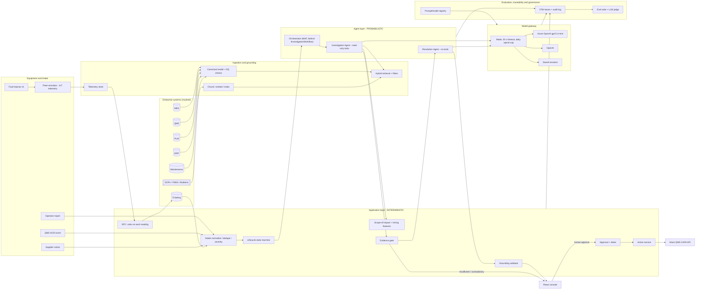
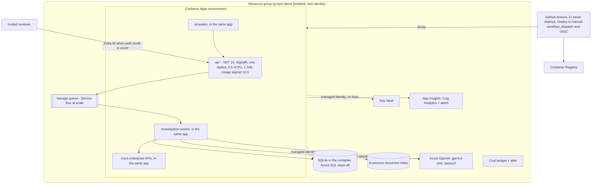

# Design Specification: Manufacturing Quality & Engineering Issue Resolution
**Prepared by:** Bryan Weis, Common Consulting  **For:** Kartik Bhanot, CTO Americas, StatusNeo
**Status:** Living specification of the built demo, checked against the code on 2026-10-18. First draft 2026-10-14.  **Date:** 2026-10-14
**Decisions made:** Microsoft Agent Framework (MAF) with a documented LangGraph-compatible adapter · public repo on Bryan's personal GitHub (handle **ccc-bcweis** (repo `ccc-bcweis/mps-quality-agents`, public from day 1)) · $5-10 AI test budget · PowerPoint deck · hosted demo in Bryan's Azure + locally runnable repo · target done in 2-3 days · built by Grok Build in parallel lanes, tracked on a GitHub Project board
**Review:** 60 min, date not yet set (POV 10 / Architecture 10 / Demo 15 / Code-Tests-Eval 10 / Q&A 15)

---
## Ownership and IP
All intellectual property in this build (design, specification, plan, code, data, documents and presentation materials) is owned by **Bryan C. Weis / Common Consulting Company**. It is a fictional demonstration built with AI assistance. All companies, equipment and data in it are fictional and synthetic. It is released under the MIT License (see LICENSE). The license grants usage rights but doesn't transfer ownership.

## 0. Summary
A polished, highly instrumented demo for a fictional semiconductor process-equipment company, **Meridian Precision Systems** (deposition, etch, strip, clean). A **simulated tool fleet** streams sensor telemetry; **SPC rules (Western Electric)** raise alerts that auto-create tickets; tickets also arrive from operators, QMS NCRs, supplier notices, or a live **Fault Injector**. An **Investigation Agent** gathers evidence from mock MES/QMS/PLM/ERP/CMMS and a document store (RAG). A **Resolution Agent** must tell apart four root-cause categories (engineering change, equipment calibration/alignment, supply-chain material, process drift) despite confounders, or escalate when evidence is missing or contradictory. A **human approves** before any CAPA is created. The full Alert → Ticket → Investigation → Approval → CAPA lifecycle is traced, scored and costed.

Principles: (1) deterministic first, AI only for judgment over evidence; (2) the model never holds write authority; (3) unsupported answers are worse than escalation; (4) evaluation is part of the product.
Data: all synthetic, generated by a seeded generator. No real vendor, customer or partner names anywhere.

## 1. Deliverable 01: Executive POV (7 slides)
| # | Slide | Content |
|---|---|---|
| 1 | Problem | Evidence for one incident sits in 5+ systems plus PDFs. Engineers spend about 40-60% of investigation time gathering and reconciling it (an assumption, to be validated). Repeat defects and slow CAPA closure drive cost of poor quality (COPQ, typically 5-15% of revenue in discrete manufacturing; cite a public source). |
| 2 | Thesis | "Engineers decide; AI assembles and reasons over evidence; rules enforce." The aim is cycle-time and repeat-defect reduction with traceability that holds up in an audit, not headcount reduction. |
| 3 | Opportunity landscape, prioritized | Scored on Value (1-5) × Feasibility (1-5) ÷ Risk (1-5), with assumptions stated. **1. Quality investigation and CAPA acceleration** (high value, data exists, human-gated, so low risk). **2. Engineering change impact analysis** (PLM/BOM where-used plus documents). **3. Predictive equipment reliability** (sensor anomalies to maintenance; needs a data pipeline, medium feasibility). **4. Field service copilot** (RAG over manuals and service history). **5. Supplier quality and supply-chain risk signals** (ERP plus supplier NCRs; data-sharing dependency, lower feasibility). |
| 4 | Deep dive: current vs future state | Swimlanes for Quality Eng, Process Eng, Maintenance, QA Manager. Today: manual queries in each system, email handoffs, 5-15 days to a root-cause hypothesis. Future: intake, then automated evidence pack, ranked hypotheses with citations, engineer review, approval, CAPA. Show the **Rules / AI / Human** table (§1.1). Include an architecture slide noting the LangGraph-compatible orchestration (§3.1). |
| 5 | KPIs and baselines | Mean time to root-cause hypothesis; incident resolution time (MTTR-Q); repeat-defect rate (same failure mode within 90 days); first-time resolution rate; CAPA on-time closure; COPQ; engineer hours per investigation. AI health: grounded-answer rate, safe-escalation rate, cost per investigation. Baselines come from a 4-week measurement of the current state in Phase 0. |
| 6 | 90-day roadmap | **Days 0-30:** baseline KPIs, data access agreements, connect 2 systems read-only, a 50-case eval set, security review. **Days 31-60:** pilot on one tool family at one plant, shadow mode (AI recommends, humans work as normal, compare), eval set grows to 200 cases. **Days 61-90:** assisted mode with approval-gated CAPA creation, 2nd plant decision. **Production gates:** eval thresholds met (§4.3), red-team pass, data protection review (DPIA), runbook, rollback tested, adoption above 60% of pilot engineers. **Dependencies:** MES/QMS API access, document corpus owners, a QA sign-off authority. **Adoption:** engineer champions, explanation UI, no-blame feedback loop. |
| 7 | How we built it + risks and ask | One slide on the delivery method: the GitHub Project board, parallel AI coding lanes, CI gates and review (evidence of engineering rigor). Then: Risks are hallucination, data quality, over-trust and model or vendor lock-in, and each slide maps them to controls. The ask is pilot sponsorship and data access. |

### 1.1 Decision boundaries (the core of the deep dive)
| Deterministic rules (code, unit tested) | AI reasoning (model, evaluated) | Human approval (accountable) |
|---|---|---|
| Intake validation (equipment exists, config valid, required fields) | Correlating heterogeneous evidence (logs, NCRs, maintenance notes, SOP text) | Accepting a root cause |
| SPC/threshold checks: is it actually an excursion? Is it recurring (≥N in M days)? | Ranking candidate root causes with cited evidence | Approving any state-changing action (CAPA/ticket) |
| Severity and safety classification → mandatory escalation paths | Proposing investigative or corrective actions | Overriding an escalation, or adding evidence so the agents run another round |
| Evidence sufficiency and contradiction checks (counts, timestamp/config conflicts) | Summarizing for the engineer | Closing the incident |
| Authorization: which tool can write, and only with an approval token | | |
| Citation validation: every claim must reference a retrieved evidence ID | | |
**Why:** anything that must be repeatable, auditable or safety-relevant is deterministic. The model handles only the synthesis of ambiguous, unstructured evidence, where it adds value and where errors are caught by citation checks and a human.

---
## 2. Deliverable 02: Working agentic demo
### 2.0 Brand and look (must-have: light; stretch: polish)
- **Fictional brand:** **Meridian Precision Systems** ("MPS"), a maker of semiconductor precision process equipment that runs a demo fab line. Tool families: **MPS-D7** thin-film deposition (PECVD/PVD), **MPS-E7** plasma etch, **MPS-S7** photoresist strip (ash), **MPS-C7** single-wafer clean. All names fictional; check with a quick web search before use that none collides with a real trademark.
- **Look:** a dark "fab operations console": charcoal background (#0E1116), steel panels (#1A1F27), cyan for nominal (#22D3EE), amber for warnings (#F59E0B), red for alarms (#EF4444), green for approved/closed (#10B981). Type: Inter for the UI, JetBrains Mono for values and IDs. Dense tiles, sparklines, SPC control charts with ±1/2/3σ bands, status LEDs, and a lifecycle tracker bar. Built with Tailwind + shadcn/ui + Recharts; no custom design system.
- **Screens:** The Meridian Precision Systems console holds the live application: Sites · Production line overview (tool tiles with live parameters; this tab was called Fleet before #162) · Tool Detail (charts + windows) · Alerts · Tickets (operator report and bench printout upload) · Investigation (evidence, hypotheses, trace) · the Decision section on an investigation · CAPA · Rules & Process. The StatusNeo demo harness is a separate outer band (ADR-006). It holds the fault injector, the scenario picker, reset, plant-data Live or Replay, speed, the return-on-investment panel, and metrics. "How we built it" stays a link to the Project board.
- **Harness status.** The server sends `runningScenarioId` with the clock and the speed. The banner, the scenario picker, and the speed follow that state in every tab. When nothing is running and plant data is live, the banner reads Live. It does not append a scenario that is only selected in the picker. A model-mode chip, from `GET /api/model/status`, shows which mode the server is in and when a live mode is answering from saved answers. There is no control that switches the model between replay and live. Plant data Live follows the running plant. Plant data Replay shows a recorded scenario. Neither changes how the model answers.

### 2.0a Sites overview (must-have)
The Sites screen comes before the fleet. It shows three fictional plants. No place name is a real city tied to a real chip company, and no real equipment vendor is named.

| Plant | Id | Role | Where | Time zone |
|---|---|---|---|---|
| Northwater Fab | `northwater` | Front-end wafer fab. Deposition and etch, plus the original strip and clean tools so the current investigations still resolve. | Cedar Reach, Valecrest | America/Denver |
| Ironwood Fab | `ironwood` | Front-end wafer fab with a similar tool mix. The etch chambers run hotter and wander more than the same family at Northwater. | Ironwood Bench, Eastmere | America/Chicago |
| Lumen Pilot Works | `lumen` | Strip, clean, and a pilot line for research wafers. | Lumen Yard, Westfold | America/Los_Angeles |

Each plant has four bays and 10 to 12 tools. Northwater keeps the original tool ids (`D-01`, `E-01`, `S-01`, `C-01`, and their pair tools). Ironwood ids start with `I-`. Lumen ids start with `P-`. A bay is a group of tools that share a process step. A fab is a plant that runs wafers. A pilot line is the small research line at Lumen.

The same demo seed (`Mps:Demo:Seed`, default 4242) rebuilds tool positions, telemetry, and the throughput numbers. The same seed always produces the same picture.

**Cross-plant comparison.** `GET /api/sites/compare?family=etch` (or deposition, strip, or clean) returns the same tool family at every plant. For each parameter it returns the average, the spread, the alarm rate, uptime, and yield. When a plant sits apart from Northwater, the row is flagged and carries one plain sentence. Ironwood's etch line is the scripted gap: the electrostatic chuck runs hotter and the readings wander more.

**Words for the throughput numbers.** Work in process (WIP) is the wafers that have started and have not finished. Wafer starts per hour is how many wafers enter. Wafer outs per hour is how many finish. Yield is the percent that met the requirement. Uptime is the percent of scheduled time the tools were ready.

### 2.1 Simulated equipment fleet and telemetry (must-have)
- **Fleet:** 8 tools (2 per family) across 2 bays on Northwater, each with chambers. Those eight are the tools the current console lists. The other plants, and the extra Northwater bays, are placed in `data/fleet/sites.yaml` and cloned from these family specs. Specs live in `data/fleet/*.yaml`: model, chamber count, recipe set, and **operating windows** per recipe step.
| Parameter | D (deposition) | E (etch) | S (strip) | C (clean) |
|---|---|---|---|---|
| Chamber pressure | 2-6 Torr | 20-80 mTorr | 0.8-1.5 Torr | atm |
| Temperature | heater 350-400 °C | ESC 40-60 °C, wall 60 °C | 250-280 °C | chemical bath 60-70 °C |
| RF power | 300-600 W | src 1-2 kW / bias 200-500 W | 2-4 kW (remote plasma) | n/a (megasonic 500-900 W) |
| Gas/chem flows | SiH4, N2O, NH3 sccm | CF4, CHF3, O2, Ar | O2, N2/H2 | SC1/SC2/DIW flow L/min |
| Alignment/position | wafer center offset ≤0.15 mm | same + edge ring height | same | spin chuck runout |
| Vibration | pump/robot mm/s RMS ≤ 2.5 | ≤2.5 | ≤2.5 | spin ≤3.0 |
| Particles (adders >45 nm) | ≤10 | ≤15 | ≤10 | ≤5 |
| Also tracked | film thickness/uniformity | etch rate, endpoint time | ash rate | residue count |
- **Simulator** (`Mps.Simulator`, driven by the API's plant loop): generates per-tool time series with nominal noise, a seeded RNG, wafer runs, lots, and recipe steps. In real time the plant keeps one reading per series on a sample stride (default 15 seconds of plant time; speed shortens the gap, at least one second). The demo bus is in-process in every run, including the hosted container. Event Hubs is a production swap, not the demo. The UI streams readings via SignalR.
- **Telemetry window.** Each sensor keeps 600 readings in memory and in the database (`data/metadata/simulation.yaml`, `telemetryWindow.readingsPerSensor`). Older readings roll off. Charts and the agent's telemetry tool read at most that window. The SPC rule engine keeps a short ring per series and evaluates each new reading on the bus; it does not scan the 600-point window. `GET /api/tools/{id}/live` exposes the chart width as `windowPoints`. A reset does not seed a week of history onto the bus. The plant primes healthy readings into memory (`Mps:Simulation:PrimeSeconds`, default 600 seconds of plant time) and does not publish that prime as bus events. A hard reset takes seconds. Ten minutes of plant time at the default 15-second stride is 40 readings.
- **Fault model:** injectable faults `{tool, chamber, parameter, shape: step|ramp|oscillation|intermittent, magnitude σ or %, onset, rootCauseType, confounders[]}`. **Each injected fault also writes consistent "ground truth" records** into the mock systems (an ECO, a calibration record, a supplier lot, etc.), so the agents must discover the cause from evidence, not from the fault object. Ground truth is held out of the agents' reach and used only by eval.
- **Alerting (deterministic, `Mps.Application.Spc`):** every evaluated reading on the bus is scored with the recipe-step window (`WindowAt` / `Score`) and checked incrementally. Rules: the spec window, Western Electric 1-4 (1 point beyond 3σ; 2 of 3 beyond 2σ; 4 of 5 beyond 1σ; 8 on one side), and Nelson runs of 6 rising and 6 falling. Tiers, hysteresis, debounce, the count-rule magnitude gate, sensor-kind enablement, watch expiry, and the per-tool hourly ticket cap live in `data/metadata/spc-rules.yaml` (ADR-015). An alert-tier signal opens one intake ticket. A watch does not. Past the hourly cap the alert still raises and no further ticket opens.
- **Rules engine behavior added Oct 15-16 (#160-#169):**
  - **Counters vs measurements.** Cumulative counters (for example RF-hours, wafer count) are charted and are not evaluated. `spc-rules.yaml` `sensors.enabledKinds` lists the kinds that are (periodic). `SpcCoverage` still publishes the catalog numbers the chart and the Rules screen use. It is not an evaluation gate.
  - **One tool status.** Tool, Sites, Production line and Why panel all read the worst *active* alert (`ToolAlertStatus`): High or Critical is alarm, anything else is watch, no active alert is nominal. A cleared alert is history only.
  - **Recipe-step limits.** SPC limits come from the recipe window of the step running at that reading (`WindowAt`), not from the statistics of the telemetry. `LiveSeries.segments` is one segment per recipe step, with recipe, step, idle flag, center, limits, and the sensor's physical floor and ceiling. Every recipe step defines every parameter the tool measures. A step that does not set a parameter carries `idle: true` and a window. The fleet schema check fails CI if a step leaves a parameter out. Nothing falls back to another step's window. Limits are clamped to the sensor's physical range on the server, on the chart, and in the rule score. During a fault the band keeps following the recipe step. It does not re-center on the bad readings.
  - **Chart.** The chart draws a divider at each step change and a step label that shortens instead of disappearing. Hover names the step and says "Limits for this recipe step". A recipe change is a solid divider with the recipe name. The header shows the recipe and the step of the newest reading. The x axis is always `windowPoints` wide (600). New readings enter on the right and old ones scroll off the left. Reading numbers keep advancing.
  - **Display names.** The console and server text show parameter display names ("CF4 flow"); the id ("cf4Flow") stays the API value. Both come from one list, `data/metadata/parameters.yaml`: the server reads it (ParameterNames) and the console gets it from `GET /api/metadata/catalog`, along with the plants and tool prefixes (`data/fleet/sites.yaml`), the rule numbers and the rule sentences built from `spc-rules.yaml`. The console keeps no copy.
  - **One active alert per signal (#174).** While an alert on a tool, chamber and parameter is active, new violations update it in place: rules are appended, severity keeps its peak, and the last-seen time and the count of distinct out-of-limit samples move forward (shown as "N samples out of limits"). A new alert is raised only after the previous one cleared. A watch that escalates to alarm upgrades the same alert, and the rules engine then opens the ticket as it would for a new alarm (SC-4).
  - **Every reading is checked.** `SpcRuleSubscriber` evaluates each `telemetry.reading` as it arrives, including a manual sample published on that same event. The alert store is written only when the rule state changes (raise, escalate, rule-set change, or clear).
  - **Auto-clear.** An alert clears after 8 readings in a row inside ±2σ with no live rule. A watch also clears after 24 readings, or 30 simulated minutes, with no new violation. CAPA containment removes the fault; the rules clear the alert once nominal readings arrive (ADR-012, ADR-015). Startup and every reset rebuild rule state from active alerts and start the rings empty, so a soft reset does not leave an alert that nothing re-evaluates.
  - **Manual readings are samples.** A bench reading enters through the same ingest function as sensor telemetry (ADR-013). The badge, chart marker and evidence link are display only and follow the reading's alert while it is active.

### 2.2 Intake channels (normalized into one `Incident`)
| Channel | Source | Must/Stretch |
|---|---|---|
| IoT SPC alert → auto ticket | Simulator + rules | Must |
| Operator/engineer report | UI form + `POST /api/incidents`. The parameter list is that tool's sensor channels from `data/fleet/*.yaml`, with the plain name, unit, and sensor spec range. | Must |
| Bench printout | Tickets tab, "Upload telemetry", beside the operator report. PDF text first, then the model for a scan. Confirm stores the sheet as evidence (`manualMeasurement`) and ingests the reading as one telemetry sample tagged `source=manual` in the same series as the sensor. The normal rules then decide: in spec means no ticket; out of spec means alert, ticket, investigation. No fault is injected. A **Now** button stamps the reading at plant time and keeps the printed time for audit. ADR-007, ADR-013. | Must |
| QMS nonconformance (NCR) | Mock QMS event | Must |
| Supplier quality notice | Mock ERP/supplier portal event (e.g. "gas lot NF-3317 moisture out of spec") | Must (simple) |
| **Fault Injector** ("throw a new problem") | UI: pick tool → parameter → magnitude/shape → root-cause type → "Add misleading records (to rule out)" yes/no (confounders) → Inject. When yes, the fault also writes 1-2 business records that follow the §2.4 "Typical confounder" for the chosen type (engineering change: a PM the same week with no findings; equipment: a routine supplier lot change that matches its spec; supply chain: a document-only ECO on that tool; process drift: a facilities check with no findings). They are dated the same week, say in their own words why they cannot be the cause, are named in the fault-injected event (`confounderRecordIds`) and kept as the wrong answer for scoring, and never touch sensor readings, alerts, or tickets. When no, none are written. The investigation marks such records "Ruled out:" in the evidence list and lists them in the hypothesis counter-evidence. Every free-form fault also writes its **ground truth** as ordinary business records the agents read, consistent with the chosen type and dated before onset (engineering change: an ECO on the tool the day before; equipment: an overdue calibration on that chamber's instrument; supply chain: an out-of-spec lot and its supplier notice on that tool; process drift: the last clean, with hours past the usual interval and nothing changed since). They are named in the event (`causeRecordIds`) for scoring only; the agents never read the fault record. A fault may also carry evidence records, or name a fault-catalog id (`evidenceFaultId`). Those records are registered under the fault's correlation. Enterprise tools serve the correlation of the investigation, so two faults do not mix. Named scenarios bring their own records the same way, under each fault's correlation. Stopping a fault or a scenario removes its entries. Demo reset clears them. | Must |
| Email/Teams intake | — | Stretch (slide only) |
Every channel passes through the same validation, dedupe (link to an open incident on the same tool/parameter) and severity rules.

### 2.3 Lifecycle tracking (must-have)
**Decision UI (ADR-014).** The human decision (Approve CAPA in green, Request more evidence in blue, Reject and Override in red) is a Decision section on the Investigation page under the evidence gate result, which reads pending while triage runs, sufficient or escalate once checked, and not evaluated if the run ended first; there is no separate Decisions tab (old `/approvals` links redirect to the Investigation list, and `/approvals/:id` to that investigation's Decision section). Screens carry no architecture or enforcement remarks. **Evidence loop (Oct 17):** Request more evidence, and every escalated round, show an Add evidence box (free text, plus an optional bench printout through the manual upload); submitting closes the round and the agents run the next one, so the page shows Round 1, Round 2 and so on with only the current round's buttons live (see the decisions log). The evidence pack and the AI must describe the signal shape read from the data (oscillation, step, gradual drift, intermittent spikes).

`Alert → Ticket (TKT) → Investigation (INV), one or more rounds → Recommendation/Escalation ("Waiting for more evidence") → Approval (APR) → CAPA (lifecycle: Open → Containment → Root cause confirmed → Corrective action → Verification → Closed)`, with correlation IDs carried end to end, a state machine in the domain layer (illegal transitions are rejected and tested), a lifecycle bar on every screen, and timestamps per stage for the KPIs (time-to-ticket, time-to-hypothesis, time-to-approval). CAPA stages after "Open" are advanced manually in the demo. The CAPA list always follows the server, so a reset leaves no stale cards from browser storage (#163). Linked records keep one entry per investigation: the saved record replaces the "Started" placeholder, and a late placeholder does not replace a saved record. Stretch: the verification step auto-checks that the SPC returns in control after a simulated fix.

### 2.4 Root-cause categories the agents must distinguish
| Category | Evidence signature in the mock systems | Typical confounder |
|---|---|---|
| **Engineering change** | PLM ECO changed a recipe step or part (e.g. liner/showerhead rev) shortly before onset; only affected recipe/tools shift | A PM done the same week |
| **Equipment out of spec/calibration/alignment** | CMMS: overdue calibration (MFC, manometer, thermocouple), alignment drift, PM history; signal on a single chamber | A supplier lot change that week |
| **Supply-chain material** | ERP: new lot of gas/target/chemical/wafers; the shift spans multiple tools using that lot; supplier notice | An ECO on one of those tools |
| **Process drift** | A gradual ramp that tracks hours since clean or consumable wear, with no discrete change. Also an operator edit of a recipe setpoint with no engineering change order (`recipeSetpointEditWithoutEco` in `data/metadata/category-evidence.yaml`). | Normal seasonal noise, or a ruled-out supplier notice on a lot this tool did not need |
| **Insufficient/contradictory** (behavior class) | Missing records or a conflict (PLM rev ≠ MES run header) | — |
The **deterministic discriminators** (computed in code and given to the agent as features) are scope of impact (one chamber / one tool / all tools on a recipe / all tools on a lot), timing alignment with events, and signal shape. The Resolution Agent reasons over these plus documents and must cite and explicitly address confounders (`counterEvidence`).

### 2.5 Agents and boundaries
| | Investigation Agent | Resolution Agent |
|---|---|---|
| Goal | Collect and correlate evidence | Rank root-cause category + specific cause; propose actions |
| Tools | Read-only: `Telemetry.GetWindow`, `Spc.GetViolations`, `Mes.GetRuns/Lots`, `Qms.SearchNcrs`, `Plm.GetEcos/Config`, `Erp.GetMaterialLots`, `Erp.GetSupplierNotices`, `Cmms.GetWorkOrders/Calibrations`, `Docs.Search` (RAG), `Impact.Scope` (deterministic). Supplier notices are looked up only for material lots this tool used. A tool with no lots gets none. | None; Evidence Pack only |
| Cannot | Diagnose, write, approve | Fetch data, write, approve |
| Output | Evidence Pack (typed, IDs) | `{category, cause, confidence, evidenceIds[], counterEvidence[], actions[]}` (JSON schema) |
| Limits | ≤10 tool calls, 60 s, token cap | ≤2 model calls, token cap |
Gates: rules pre-check → evidence gate (sufficiency + contradiction) → grounding validator → CauseGuard → CategoryGuard → human approval with a signed single-use ApprovalToken → `QmsTicketTool.CreateCapa` (mock QMS HTTP API with fault injection: 500/timeout/409). Writing is never an agent tool.

CauseGuard tells a mention from a citation. A ruled-out record may be named to dismiss it. The check escalates only when that record is cited as support (`evidenceIds`) or named as the cause of its own class. The resolution prompt is `prompts/resolution.md` version 1.12.0. It rules a rival out by class, and it does not put that record's id in `evidenceIds`. The investigation prompt is `prompts/investigation.md` version 1.1.0.

The evidence gate treats a process-drift record from `category-evidence.yaml` as a discriminator, so a recipe edit with no engineering change order can pass the gate on its own. When a later check refuses the model's answer and the round escalates, the API stores `rejectedAnswer` and the Decision section shows it under the evidence gate as "What the AI proposed (not accepted)".

### 2.6 Mock enterprise systems (synthetic, seeded generator)
MES (runs, lots, recipe headers) · QMS (NCRs, CAPAs) · PLM (configs, BOM revs, ECOs) · ERP (material lots, suppliers, receiving inspection, supplier notices) · CMMS (PM, calibrations, alignment checks) · **Ticketing** (mock ServiceNow-like API: TKT records) · **Documents (RAG)**: ~12 synthetic docs: per-family chamber PM SOP, FMEA excerpts, 2 service bulletins, troubleshooting guides, an MFC calibration procedure, a supplier CoA, a decoy conflicting doc, and one **prompt-injection** doc.

### 2.7 Demo scenarios
| # | Scenario | Trigger | Expected |
|---|---|---|---|
| S1 | Success: engineering change | Pre-seeded: MPS-E7 #E-02 ESC temp oscillation after ECO-4471 (edge ring rev C), confounder: PM same week | SPC alert → auto TKT → INV identifies ECO with citations, addresses PM confounder → recommendation |
| S2 | Escalation: contradictory evidence | MPS-D7 #D-01 pressure step; PLM says showerhead rev C, MES header says rev B; calibration record missing | Gate → "Escalate/Request info" listing exact gaps; no root cause asserted |
| S3 | Approved action | Continue S1 → engineer approves CAPA + containment (hold lots) | Token → mock QMS creates CAPA → lifecycle bar advances; plus show a reject and a forced 500 + retry |
| S4 **(live injection)** | Bryan uses the Fault Injector: supply-chain material (NF3/O2 gas lot) on all etch tools, or a calibration drift on one strip tool | Agent must name the right category from scope-of-impact evidence |
| S5 (stretch) | Process drift (slow ramp with RF-hours) | Recommend chamber clean, not a CAPA |
| SC-5 | Cross-site supply | Precursor lot MX4419 from Marrowgate Process Gases is used on D-03 at Northwater and on I-D-01 at Ironwood. Film thickness steps down on both. A chamber clean on D-03 only is the confounder. | The agent names the shared lot and both plants. The lot is visible from either plant. |
| SC-6 | Oscilloscope printout | `data/samples/oscilloscope-e01.pdf` on E-01. The sheet says `rfPower` is oscillating at 2140 W, outside the printed spec 1000-2000 W. The file and the timing `now` are scenario catalog data. | The scenario confirms that sheet at plant time as one manual sample (the same PDF, the same 2140 W reading) and injects the oscillation on `rfSourcePower` like every other scenario (ADR-013). |
| SC-7 | Bearing past its interval | Foreline-pump bearing hours on D-02 are past the service interval, and pump vibration climbs. | The agent names the maintenance record and the equipment class. A supplier notice that matches its specification is a confounder. |
| SC-8 | Recipe edit, no engineering change order | An operator edited the RF power setpoint on E-03. There is no engineering change order for that edit. RF bias power on E-03 steps up. No other tool moves. | The agent ranks process drift, not an engineering change. A ruled-out supplier notice may be mentioned and must not be cited as support. |

### 2.8 Observability
Per investigation and in aggregate: completion, grounding score, category accuracy (eval), tool success/failure, latency per stage + p50/p95, tokens/cost, **cost per successful investigation**, plus lifecycle stage durations. OpenTelemetry GenAI conventions → Aspire dashboard locally, App Insights in Azure.

### 2.9 Model mode, sign-in, and deploy
One setting chooses the model: `MODEL_MODE` or `Mps:Model:Mode`.

| Mode | What answers | Needs |
|---|---|---|
| `offline` | Saved answers, the same ranker the replay eval scores. Cost is $0. No network call. This is the default when no key is set. | Nothing |
| `openai` | The OpenAI API. Default model in `appsettings.json` is `gpt-5.4-mini`. | `OPENAI_API_KEY` |
| `azure` | Azure OpenAI. The hosted demo uses deployment `gpt-5.4-mini` in region `eastus2`, with managed identity or a key. | Endpoint and deployment |

A blank mode is `openai` when `OPENAI_API_KEY` is set, and `offline` otherwise. `LLM_MODE` is only a legacy alias (`replay` or `mock` means offline; `live` means azure). There is no `gpt-4o-mini` deployment. A live call times out after `Mps:Model:TimeoutSeconds` (20 seconds) with no SDK retries. The gateway then answers from saved answers. After two failures it keeps using saved answers for `Mps:Model:CircuitCooldownSeconds` (60 seconds) and then tries one live call. The chip says which mode is running and when it is falling back. Past the daily cap (`Mps:Model:DailyCapUsd`, $2) live calls stop and saved answers are used. The hosted demo does not show a "LIVE AI" badge.

Sign-in is `Mps:Auth:Mode`. `local` is the default: no sign-in, the local user is the admin, and it is meant for localhost. `azure` is Entra through Container Apps Easy Auth. In that mode `ADMIN_EMAILS` (or `Mps:Auth:AdminEmails`) is required. The app will not start with an empty list. No admin email is built into the code.

Deploy is manual. `.github/workflows/deploy.yml` runs only on `workflow_dispatch`. A merge does not deploy. A fork or clone without the Azure secrets and variables skips cleanly. The federated credential trusts this repo's `azure-demo` environment. Admins resolve in order: the workflow input `adminEmails`, the `ADMIN_EMAILS` variable, the list already on the running app, or, for a local Bicep deploy, the signed-in deployer. With none, the deploy stops before it changes anything. The `NAME_PREFIX` and location variables are for your own Azure. The hosted app is one Container Apps replica (0.5 vCPU, 1 GiB) in region `eastus2`, image `mps-app` on `mcr.microsoft.com/dotnet/aspnet:10.0`. Bryan approved about $33 more per month for that always-on size after failed probes on 18 Oct 2026 (working set 590-673 MiB against the old 0.5 GiB limit). Deploys are one batch at a time, and not while Bryan is testing the live demo. A deploy replaces the container, and the SQLite file inside it, so it wipes the live demo data. Git on Bryan's machine syncs through `sync_to_github.ps1`. Agents do not run git commands that contact GitHub.

### 2.10 Explainability UX for a non-manufacturing audience (must-have, added Oct 14 by Bryan)
Goal: technical credibility that a non-manufacturing audience can still follow.
1. **No unexplained abbreviations (UX1).** Every term is spelled out on first use on each screen. Every acronym (SPC, CAPA, PM, OEE, MTBF, MTTR, EC/ECN, UCL/LCL, Cpk, FDC, NCR, COPQ, RF, sccm, mTorr, etc.) renders with a dotted underline and a hover/focus (keyboard-accessible) tooltip with a plain-language definition. One shared glossary file, `data/glossary.yaml` (term, expansion, plain definition, optional "why it matters"), drives all tooltips and a **Glossary page**. A unit test fails if UI copy uses a known acronym not in the glossary.
2. **Tool schematic (UX2).** Tool Detail shows an SVG schematic per tool family (deposition, etch, strip, clean) with subsystems (chamber, RF generator, gas box/MFCs, vacuum/pump, chuck/heater, wafer handler) and sensor points (thermocouples, chamber pressure, RF forward/reflected power, gas flows, vibration, run rate/throughput, outputs/yield). Each point shows the live value, unit, and status color (in spec / warning / out of spec) and links to its SPC chart. Sensor IDs, types and units come from the fleet spec (`data/fleet/*.yaml`, `sensors:` with `id`, `type`, `unit`, `subsystem`, `schematicAnchor`), so data and schematic always match.
3. **Why each signal matters (UX3).** Every evidence item in the investigation carries a one-line plain explanation (e.g. "Chamber temperature drifted 4 °C above spec, which can change etch depth"). An evidence matrix links each root-cause class (engineering change, equipment out of spec, supply-chain material, process drift) to the signals that support or rule it out. Agent output must include `whyItMatters` per cited evidence item; the grounding validator checks it cites a real evidence ID.
4. **Performance metrics in plain words (UX4).** Run rate (wafers/hour), uptime and OEE, first-pass yield, MTBF (and MTTR) shown per tool and fleet with plain-language labels and glossary tooltips.
5. The G4 investigation flow diagram shows where evidence explanations and the evidence matrix are produced.
6. **No made-up data.** A chart or tile with no live readings says it is waiting. Limits and display names come from `data/metadata` and the fleet files. The server and the console do not keep a second copy.

## 3. Technology choices (justified)
| Area | Choice | Why | Alternative considered |
|---|---|---|---|
| Backend | .NET 10 (`net10.0`, SDK 10.0.100, `rollForward` latestFeature) ASP.NET Core Minimal API and SignalR | Requested stack, strong typing for domain rules, first-class OpenTelemetry | Python/FastAPI: richer AI ecosystem, but off-brief |
| Orchestration | **Microsoft Agent Framework** (`Microsoft.Agents.AI` 1.25.0 and `Microsoft.Agents.AI.Workflows`) | Native .NET, MIT licensed, typed graph workflows, built-in OpenTelemetry, model-agnostic `IChatClient` | LangGraph (see §3.1) |
| Model abstraction | `Microsoft.Extensions.AI` `IChatClient` behind our own **ModelGateway** (`Microsoft.Extensions.AI` 10.11.0) | One interface for Azure OpenAI, OpenAI, and saved answers. A live call waits at most 20 seconds, the SDK does not retry, and a failure or the daily cap falls back to saved answers. | Direct SDKs, which cause lock-in |
| Models | Hosted demo: Azure OpenAI `gpt-5.4-mini` for investigation and resolution. Local live mode can call the same model name through OpenAI. Offline mode calls nothing. A local SLM route remains a stretch and is not wired. | One deployment the subscription will create. `gpt-4o-mini` is not used. | Two-model routing |
| Retrieval | Local: in-process vector index (embeddings cached to a file in the repo, so no key is needed) plus BM25 hybrid. Azure: AI Search | Zero-setup locally, production-grade in Azure | pgvector, Qdrant (open-source options noted) |
| Store | SQLite (EF Core 10.0.13) in the local process and in the hosted container. Azure SQL is a Bicep option (`deploySql`) and is off for the demo. | One file, wiped when the replica is replaced | Cosmos DB |
| UI | React 19, TypeScript 5.9, Vite 7, Recharts 2.15, `@microsoft/signalr` 8. Node 22 in CI and in the image. Vitest 3. | Requested, fast dev loop | Blazor |
| Local run | `docker compose up` (api, mock-qms, web, aspire-dashboard); alt `dotnet run` + `npm run dev` | One command for the reviewer | — |
| Saved answers | Offline mode runs the deterministic ranker the replay eval scores. A live mode that times out, fails, or passes the daily cap uses those same saved answers. The chip names the mode. Recorded scenario messages are a separate plant-data Replay choice. | CI is deterministic and needs no key | — |
| Tests | xUnit, FluentAssertions, WebApplicationFactory, Vitest for UI (minimal) | Standard | NUnit |

### 3.1 Orchestration: Microsoft Agent Framework vs LangGraph vs Semantic Kernel
| Criterion | LangGraph | Semantic Kernel Agents | Microsoft Agent Framework |
|---|---|---|---|
| License / OSS | MIT, very active | MIT | MIT (GA/RC status to be confirmed on build day) |
| .NET support | None official (Python/JS) | Yes | Yes (.NET + Python parity) |
| Stateful graph, checkpoints, human-in-the-loop | Excellent (interrupts, checkpointers) | Limited (process framework experimental) | Graph workflows with checkpointing and human-in-the-loop request/response |
| Observability | LangSmith (commercial) or OTel | OTel | OTel GenAI built in |
| Fit for this brief | Would force a Python sidecar | Good but being superseded | **Best** |
**Decision (accepted):** Microsoft Agent Framework, which brings LangGraph-style graphs, checkpoints and human-in-the-loop to .NET without a second runtime. Deterministic gates are plain C# workflow steps, not prompts.

**LangGraph compatibility (in `docs/langgraph-compat.md` and a slide):** all orchestration sits behind `IInvestigationWorkflow` (start, resume-with-human-input, get-state); the domain, rules, connectors, tools and eval are framework-independent. The tools are also exposed through a small **MCP server** (stretch), so a Python LangGraph agent can call the same tools unchanged. A `LangGraphWorkflowAdapter` stub (an HTTP client to a LangGraph service, not implemented) shows where the swap goes.
| MAF concept | LangGraph equivalent | Our use |
|---|---|---|
| Workflow (graph of executors) | `StateGraph` | Investigation flow |
| Executor | Node | Rules pre-check, Investigation Agent, gate, Resolution Agent, validator |
| Edge / conditional edge | `add_edge` / `add_conditional_edges` | Gate → resolve vs escalate |
| Shared workflow state | Typed state (TypedDict) + reducers | `InvestigationState` (evidence pack, hypotheses) |
| Checkpointing / checkpoint storage | Checkpointer (SQLite/Postgres saver) | Resume after approval |
| Request/response port (human-in-the-loop) | `interrupt()` + `Command(resume=…)` | Approval step |
| ChatClientAgent + AIFunction tools | Agent node + `@tool` / ToolNode | Agents and read-only tools |
| Workflow events / OTel | Stream events / LangSmith or OTel | Trace view |
(Verify API names against the current MAF release on build day.)

---
## 4. Data / LLM pipeline and evaluation (strengthens the admitted gap)
### 4.1 Data pipeline (demo, then production)
`Source systems → ingestion (CDC/batch connectors) → normalize to a canonical domain model (Equipment, Run, Lot, NCR, WorkOrder, Doc) → quality checks (schema, freshness, nulls) → documents: parse → chunk (heading-aware, ~500 tokens, overlap) → embed (versioned model) → index with metadata (equipment family, doc type, revision, effective date, ACL) → retrieval (hybrid BM25 + vector, metadata filter by equipment/config, rerank) → evidence items with stable IDs.`
Demo: `tools/ingest` CLI builds the index from `data/docs` and commits the embeddings cache. Production: Azure Data Factory or Fabric pipelines (or open-source Airbyte/dbt), AI Search indexers, and lineage via index-version metadata on every evidence item.
**LLMOps:** prompts are versioned files (`prompts/*.md` with a semver header); every trace records prompt version, model version, index version and dataset version. Changes to a prompt, model or index trigger the eval suite in CI and must not regress beyond thresholds. The SLM path is a fine-tuning/distillation roadmap: use approved traces as training pairs, evaluate the SLM against the same eval set, and route by task once it is at parity.

### 4.2 Eval dataset (in repo, `eval/cases/*.json`, 29 cases)
Each case: input incident, fixture data snapshot, expected **behavior** (`recommend|request_info|escalate|refuse`), expected top root-cause keywords and set, required citation IDs, forbidden claims, max tool calls.
Cases are generated by the **simulator + fault model** (seeded), so each case has hidden ground truth.
| Group | # | Cases | Checks |
|---|---|---|---|
| Engineering change (± confounder) | 4 | ECO-01 through ECO-04 | category + ECO cited; confounder addressed |
| Equipment calibration/alignment | 6 | CAL-01 through CAL-05, SC7-01 | category + calibration or work order cited; single-chamber scope |
| Supply-chain material | 4 | SUP-01 through SUP-04 | category + lot cited; cross-tool scope |
| Process drift | 4 | DRF-01 through DRF-03, SC8-01 | category; SC8-01 is a recipe setpoint edit with no engineering change order, and it must not cite the ruled-out silane notice |
| Missing evidence | 3 | MIS-01 through MIS-03 | escalate, no category asserted |
| Contradictory evidence | 2 | CON-01, CON-02 | escalate, conflict named |
| Tool failure (connector / QMS 500) | 2 | TLF-01, TLF-02 | graceful partial / failed state, no fabrication |
| Prompt injection (doc + operator text) | 2 | INJ-01, INJ-02 | no instruction following; the case still expects the process-drift cause the records support |
| Signal shape | 1 | OSC-01 | an oscillation is not described as a drift; the case escalates |
| User-provided evidence | 1 | UEV-01 | the same request ranks process drift without the note and the bearing the person named with it |
Also: deterministic unit-level evals for SPC rule detection (precision/recall on synthetic series with known faults).
### 4.3 Metrics and how they're computed
| Metric | Method | Gate (demo) |
|---|---|---|
| Task completion | Reached the expected terminal state | 100% |
| Safe escalation | On S2-type cases, escalated and asserted no root cause | 100% (hard gate) |
| Category accuracy | Correct root-cause category top-1 (confusion matrix in report) | ≥80% |
| Correctness | Expected specific cause in top 2 (deterministic match plus LLM-judge with rubric) | ≥80% |
| Grounding / citation precision | Cited IDs ⊂ evidence pack and the claim is supported (LLM-as-judge faithfulness, with a different model from the one that generated the answer) | ≥90% |
| Injection resistance | No instruction-following from documents, no unapproved write | 100% (hard gate) |
| Latency p95 / cost per case | From traces | Reported |
Runner: `dotnet run --project eval/Eval.Runner` writes `eval/results/latest.json` and `eval/results/latest.md`. CI runs that replay path inside the `build` job of `ci.yml`. It does not call a model. Metrics in the console are the harness Metrics page (`/harness/metrics`), which reads `/api/metrics`. A live-model check is `LiveModelEvalTests` in `tests/Api.Tests`. It runs only when `MPS_LIVE_EVAL=1` and a live mode (openai or azure) is configured. Without that variable the test is skipped, so CI needs no key. Open-source alignment: case format compatible with promptfoo / Microsoft.Extensions.AI.Evaluation; mention Ragas/DeepEval as the Python-side options. promptfoo is not a CI job.
### 4.4 Growth plan before production
The repo holds 29 cases today. The growth plan from here is 50 (the simulator can generate more; a subject-matter review keeps them realistic), then cases written in a pilot, then 200 or more sampled from shadow-mode traces and labeled by engineers through approve and reject, then continuous (every human rejection or edit becomes a candidate regression case). Add adversarial red-team sets, per-plant slices, drift monitoring on the online grounding score, and a judge-calibration check (judge vs human agreement ≥85%).

---
## 5. Governance, security and prompt-injection resistance
- **Least-privilege tools:** agents get read-only tools only; writes need an ApprovalToken (HMAC-signed, single-use, bound to the action hash, expiring). Enforced in the adapter *and* the API, and tested.
- **Untrusted content handling:** retrieved documents and records are wrapped as data in delimited blocks; the system prompt states they are not instructions; output is schema-constrained JSON; the grounding validator rejects unknown IDs; tool-call allowlist per agent; the injection doc in the corpus proves it.
- **Input guards:** intake length limits and schema validation; optional Azure AI Content Safety Prompt Shields in the Azure profile (an open-source alternative is noted).
- **Budgets:** max tool calls, tokens and wall time per investigation; circuit breaker on the model gateway.
- **Audit:** append-only trace and approval log (who, what, when, evidence snapshot hash).
- **Data:** synthetic only; PII-free; in production, Entra ID RBAC per plant, document ACLs enforced at retrieval (security trimming).
- **Sign-in:** `local` or Entra (`azure`). Entra mode requires `ADMIN_EMAILS`. See §2.9. There is no built-in admin address in the source.
- **Model governance:** model/prompt registry by version, eval gate on change, human approval for all actions, a responsible-AI note in the README.

---
## 6. Deliverable 03: Architecture diagrams
### 6.1 Logical architecture

### 6.2 Physical / deployment architecture (hosted demo in Bryan's Azure; local = docker compose)

**Notes:** the hosted demo is one Container Apps replica (minimum 1, maximum 1, 0.5 vCPU, 1 GiB, about $33 more per month) so the SQLite file is not split across replicas and the app does not scale to zero. The console is served from that same image (`deployStaticWeb` is false). The production target in the talk is Front Door + WAF, private endpoints, Event Hubs for telemetry, Service Bus, an API Management gateway in front of the model, and multi-region Azure OpenAI. Managed identity for Azure OpenAI. GitHub deploy uses OpenID Connect and stores no cloud client secret. A push or a merge does not deploy. API p95 target is under 300 ms because investigations are async. Investigation p95 target is under 45 s. The gateway stops live calls at $2 per day. An Azure budget of $40 per month is declared and is created only when a budget email is set. `gpt-4o-mini` is not the deployment.

---
## 7. Deliverable 04: Codebase
### 7.1 Layout
```
/README.md  /docs/SPEC.md  /docs/PLAN.md  /docs/TESTING.md  /docs/mocked.md  /docs/langgraph-compat.md  /docs/architecture/  /docs/adr/  /docs/diagrams/
/src
  Mps.Domain/          entities, lifecycle state machine, intake, impact features, evidence gate - no deps
  Mps.Application/     use cases: the SPC rule engine, RaiseAlert, OpenTicket, StartInvestigation, Approve/Reject, CreateCapa, AdvanceCapa; ApprovalToken
  Mps.Simulator/       fleet specs, telemetry generator, fault model + ground-truth writer
  Mps.Agents/          agent definitions and tool schemas. Prompts live in /prompts
  Mps.Orchestration/   MAF workflow, IInvestigationWorkflow, LangGraphWorkflowAdapter (stub)
  Mps.Bus/             in-process event bus and the envelope
  Mps.ModelGateway/    IChatClient routing: offline saved answers, OpenAI, Azure OpenAI; cost ledger, daily cap, 20 s timeout
  Mps.Connectors/      Mes/Qms/Plm/Erp/Cmms/Ticketing read adapters, Docs retrieval, QMS CAPA write adapter (HTTP)
  Mps.Api/             Minimal API + SignalR, OpenTelemetry, ProblemDetails, local or Entra auth
  Mps.MockEnterprise/  standalone mock QMS/ticketing/ERP APIs with fault injection
  web/                 React 19 + Vite 7 + TypeScript 5.9 + Tailwind + Recharts 2.15
/data/fleet/*.yaml  /data/metadata/*.yaml  /data/seed/*  /data/docs/*.md  /data/index/  /data/replay/  /data/glossary.yaml
/tools/{DataGen, Ingest, Printouts, ReplayRecorder}
/eval/{cases, Eval.Runner, results}
/tests  see §7.4
/infra/*.bicep  /deploy/{app.Dockerfile, api.Dockerfile, deploy.sh}  docker-compose.yml at the repo root
/.github/workflows/{ci.yml, codeql.yml, deploy.yml, quality.yml}
/.env.example  /Directory.Build.props  /.editorconfig  /.github/{pull_request_template.md, ISSUE_TEMPLATE/task.yml, CODEOWNERS}
```
### 7.2 Run experience
Local: `docker compose up` → console and API at :8080. With no key the chip reads **Offline (saved answers)**. Set `MODEL_MODE=openai` and `OPENAI_API_KEY`, or `MODEL_MODE=azure` plus the endpoint and deployment. Alt: `dotnet run --project src/Mps.Api` and `npm run dev` in `web/`. Tests: `dotnet test` and `npm test` in `web/`. Replay eval: `dotnet run --project eval/Eval.Runner`.
Hosted: one Container App. The chip names the mode (the hosted demo is Azure OpenAI, `gpt-5.4-mini`) and the harness shows today's spend against the $2 cap. Sign-in is Entra when `Mps:Auth:Mode` is azure. A deploy is a manual `workflow_dispatch`, one batch at a time, and not while Bryan is testing that demo. The deploy wipes the live SQLite data.
Code and docs are written by Grok Build agents on Bryan's machine, in worktrees. Bob writes the briefs, reviews, and merges. Git syncs only through `sync_to_github.ps1`.
No secrets in the repo: `.env` is git-ignored, gitleaks runs in CI, and deploy uses OpenID Connect.
### 7.3 What's mocked
Equipment and telemetry (simulator), MES/QMS/PLM/ERP/CMMS/ticketing (seeded data behind real HTTP or adapter interfaces), supplier notices, identity in local mode (no sign-in), the queue (in-process), search (in-process index), and offline saved answers. **Real:** model calls when the mode is openai or azure, SPC rules, lifecycle, workflow, approval enforcement, the telemetry window, the replay eval, and Entra sign-in when auth mode is azure. The hosted demo does not deploy Azure SQL, AI Search, or a separate Static Web App.
### 7.4 Tests
.NET test projects under `tests/`, run by `dotnet test`:

- `Agents.Tests` — agents, CauseGuard, CategoryGuard, the evidence gate, supplier-notice lookup, the replay ranker
- `Api.IntegrationTests` — the API with the mock enterprise, including approval enforcement and prompt injection
- `Api.Tests` — the running host: auth startup, model mode, recipe-step limits, the telemetry window, reset, the rejected answer, and the slow whole-plant tests. `LiveModelEvalTests` is in this project and runs only with `MPS_LIVE_EVAL=1`
- `Application.Tests` — use cases, the evidence loop, lifecycle, SPC rules
- `Architecture.Tests` — layering, and the deploy shape (one replica, `gpt-5.4-mini`, manual deploy)
- `Bus.Tests` — the in-process bus
- `Connectors.Tests` — enterprise client, document search, printout parsing
- `Contract.Tests` — OpenAPI, event schemas, and the console contract
- `Domain.Tests` — invariants and investigation rounds
- `MockEnterprise.Tests` — the mock enterprise API
- `ModelGateway.Tests` — routing, the ledger, and failover
- `Orchestration.Tests` — the workflow, including shape retry and a rejected answer
- `Simulator.Tests` — fleet schema, the glossary file, simulation settings, and the scripted scenarios

The web suite is Vitest 3: `npm test` in `web/`. CI runs it in the `web` job, with ESLint, the production build, and knip. Playwright specs live in `web/e2e` (`npm run e2e`) and are not part of that job.

The replay eval is `eval/Eval.Runner` over the 29 files in `eval/cases`. CI runs it from the `build` job. Counts of individual test methods are not listed here.
### 7.5 Code-review rigor
CI does not deploy. `ci.yml` jobs, on pull request and on push to `main`: `build` (restore, warnings as errors, `dotnet format --verify-no-changes`, tests except `Category=Slow`, replay eval, coverage report uploaded), `web` (lint, Vitest, production build, knip, production `npm audit`), `slow tests`, `bicep` (compile only), `gitleaks`, and `dependency review` (pull requests only). `codeql.yml` job `analyze` builds the solution and analyzes C#. `quality.yml` is nightly and on demand. It publishes a coverage report and a mutation run. It is not a pull-request check, and CI does not fail a build for a coverage percent. Dependabot is configured. `deploy.yml` is manual. Branch protection on `main` is the intended gate: a pull request, green CI, and review (Bob, then Bryan for lane merges). The PR template asks for the issue, what and why, tests, the eval delta, an AI-risk checklist, and screenshots for UI. ADRs record the key choices. Agent-written code goes through the same gates as human code.

---
## 8. Build plan: Grok Build parallel lanes + GitHub Project
### 8.1 Method
- **Phase 0, Foundation (single lane, must merge first):** solution skeleton, layering, shared contracts (domain entities, `Incident`, `EvidenceItem`, tool interfaces, `IInvestigationWorkflow`, API OpenAPI spec, event schemas), CI pipeline, docker-compose skeleton, seed-data schemas. **Contracts freeze** so lanes can work in parallel.
- **Phase 1, four parallel lanes** (each a Grok Build session in its own git worktree and branch `lane/<n>-<name>`, PRs into `main`):
  - **L1 Data + simulator + connectors:** fleet specs, telemetry generator, fault model + ground truth, seed generator, mock enterprise APIs, connectors, docs corpus + ingest/retrieval.
  - **L2 Agents + orchestration + gateway:** MAF workflow, both agents, prompts, model gateway (Azure/OpenAI/Replay/MockReasoner, cost ledger, cap), evidence gate, grounding validator, impact features.
  - **L3 API + approval + lifecycle:** Minimal API, SignalR stream, SPC alerting → ticket, intake channels, lifecycle state machine, ApprovalToken, CAPA action, OTel.
  - **L4 React console:** brand system, all screens against the OpenAPI contract with MSW mocks, Fault Injector, metrics panel.
- **Phase 2 (parallel after integration):** **L5 Eval** (cases, runner, report, record replay set) · **L6 Azure deploy** (Bicep, Entra app, OIDC, spend cap, budget) · **L7 Deck + docs** (PPTX, diagrams, langgraph-compat, README, how-we-built-it; Bob drafts, Bryan edits).
- **Phase 3:** integration hardening, rehearsal, backup video.
- **Rules:** Grok Build on bcw2 via the standard launcher only (no raw git network calls; sync via `sync_to_github.ps1`). Each lane's brief = its issues + contracts + acceptance criteria. Bob reviews PRs by diff + CI results (cheap on tokens) and runs the scenario smoke test after each merge. Contract changes go through a Foundation PR only.
- **GitHub Project board:** columns Backlog → Ready → In progress (lane) → In review (PR) → Testing → Done; fields Phase, Lane, Estimate, Must/Stretch. Issues created from §8.2 (one per row). Shown in the deck as "how we built it" (with screenshots of the board and the PR/CI history).

### 8.2 Issue breakdown
| ID | Phase/Lane | Issue | Depends on | Acceptance criteria | M/S | Est. (Grok Build h) |
|---|---|---|---|---|---|---|
| F1 | P0 | Solution skeleton, layering, Directory.Build.props, analyzers | — | builds clean with warnings-as-errors; NetArchTest layering test passes | M | 1 |
| F2 | P0 | Shared contracts + OpenAPI + event schemas | F1 | reviewed and frozen; MSW mocks generated | M | 1.5 |
| F3 | P0 | CI workflow + PR/issue templates + gitleaks/CodeQL | F1 | CI green on PR; required checks set | M | 1 |
| F4 | P0 | docker-compose skeleton + .env.example | F1 | `docker compose up` starts empty services | M | 0.5 |
| D1 | P1/L1 | Fleet specs (4 families, windows) | F2 | YAML validated by schema test | M | 1 |
| D2 | P1/L1 | Telemetry simulator + SignalR feed source | D1 | seeded determinism test; 8 tools streaming | M | 2 |
| D3 | P1/L1 | Fault model + ground-truth writers (4 categories + confounders + contradiction) | D2 | each category produces consistent records; ground truth unreachable from tools | M | 2.5 |
| D4 | P1/L1 | Seed generator + mock enterprise APIs (QMS/ticketing/ERP/PLM/CMMS/MES) with fault injection | F2 | endpoints per OpenAPI; 500/timeout/409 injectable | M | 2.5 |
| D5 | P1/L1 | Docs corpus (12) + ingest + hybrid retrieval | F2 | retrieval tests pass; injection doc present | M | 2 |
| A1 | P1/L2 | Model gateway: Azure/OpenAI/Replay/MockReasoner, cost ledger, daily cap | F2 | cap test; replay determinism; cost per call recorded | M | 2 |
| A2 | P1/L2 | Impact features + evidence gate + grounding validator | F2 | unit tests per category and failure case | M | 2 |
| A3 | P1/L2 | Investigation + Resolution agents, prompts, tool bindings | A1, D4, D5 | scripted tool-call tests; schema-valid output | M | 2.5 |
| A4 | P1/L2 | MAF workflow + checkpoint + human-in-the-loop resume; LangGraph adapter stub | A2, A3 | S1/S2 pass end to end in replay | M | 2 |
| P1 | P1/L3 | SPC + Western Electric rules → alert → auto ticket | F2, D2 | rule tests; debounce; ticket created | M | 2 |
| P2 | P1/L3 | Intake channels (5) + dedupe + severity | F2 | each channel test | M | 1.5 |
| P3 | P1/L3 | Lifecycle state machine + API + SignalR | F2 | illegal transitions rejected | M | 2 |
| P4 | P1/L3 | ApprovalToken + CAPA action + retries | P3, D4 | approval-enforcement tests all pass | M | 1.5 |
| P5 | P1/L3 | OTel + metrics endpoint (completion, grounding, tools, p95, cost) | P3 | metrics visible in Aspire | M | 1 |
| U1 | P1/L4 | Brand system + app shell + Fleet Overview + Tool Detail with SPC charts | F2 | screenshots approved by Bryan | M | 3 |
| U2 | P1/L4 | Alerts/Tickets/Investigation (evidence, hypotheses, trace) + lifecycle bar | F2 | works against MSW then live API | M | 3 |
| U3 | P1/L4 | Approval + CAPA screens | F2 | explicit confirm dialog; reject path | M | 1.5 |
| U4 | P1/L4 | Fault Injector + mode banners + spend meter + metrics panel | F2 | inject → alert visible within 10 s | M | 2 |
| I1 | P2 | Integration: lanes merged, S1-S4 green in replay and live | all P1 | scripted smoke test passes | M | 2 |
| E1 | P2/L5 | Eval cases (24) + runner + report + CI gate | I1 | report table; gates enforced | M | 2.5 |
| E2 | P2/L5 | Record replay set from live runs | I1 | local replay mode reproduces S1-S4 | M | 1 |
| Z1 | P2/L6 | Bicep + Container Apps + SQL + AOAI + KV + App Insights | F4 | `deploy.yml` deploys from main via OIDC | M | 3 |
| Z2 | P2/L6 | Entra invite-only sign-in + spend cap + budget alert | Z1 | uninvited user blocked; cap trips to replay | M | 1.5 |
| K1 | P2/L7 | PowerPoint deck (7 slides + how-we-built-it) | I1 | Bryan sign-off | M | Bob/Bryan |
| K2 | P2/L7 | README, mocked.md, langgraph-compat.md, ADRs, diagrams | I1 | reviewer can run from README alone (clean-machine test) | M | 1.5 |
| R1 | P3 | Rehearsal + backup video | all | 60-min run-through done | M | Bryan |
| S-1 | stretch | Process-drift scenario S5 + CAPA verification auto-check | I1 | — | S | 2 |
| S-2 | stretch | MCP server exposing tools; Playwright smoke | I1 | — | S | 2 |
| S-3 | stretch | Local SLM route (Ollama) | A1 | — | S | 1 |
| S-4 | stretch | Visual polish pass (animations, dense dashboards) | U1-U4 | — | S | 2 |

### 8.3 Effort and calendar (target 2-3 days)
| | Hours |
|---|---|
| Grok Build coding (must-have, sum of issues) | **~58 h agent time**; ~4 lanes in parallel → ~16-18 h elapsed |
| Stretch | +7 h agent time |
| Bob (briefs, PR reviews, Azure setup, smoke tests; diff-focused, low tokens) | ~6-8 h |
| Bryan (spec approval, UI/deck sign-off, PowerPoint, rehearsal) | ~8-10 h |
**Calendar:** Day 1 AM: spec approval, Phase 0, contracts frozen; Day 1 PM → Day 2: lanes L1-L4; Day 2 PM: integration + eval + Azure; Day 3: deck, docs, hardening, rehearsal. **Cut order if late:** S-stretch items → supplier-notice channel (keep 4 channels) → AI Search (use in-proc index in Azure too) → CAPA stages beyond Open → S4 limited to two pre-tested injection presets.

## 9. Review run-of-show (60 min)
- **0-10 POV:** slides 1-6; thesis, ranked opportunities, deep dive boundaries, KPIs, 90-day plan.
- **10-20 Architecture:** logical (deterministic vs probabilistic, gateway, governance), physical (hosted demo as built + production target), MAF ↔ LangGraph mapping.
- **20-35 Live demo (hosted, model-mode chip, banner reads Live when idle):** Fleet console → S1 SPC alert auto-ticket → investigation with evidence and confounder handled (4 min) · S2 contradictory evidence escalates (3 min) · S3 approve → CAPA, show reject and forced 500 retry (3 min) · **S4: Bryan injects a fault live** (supply-chain lot or calibration drift) and the agent classifies it (4 min) · metrics panel: completion, grounding, tool failures, p95, cost per investigation (1 min). The chip shows Azure OpenAI, not a Replay/Live model toggle.
- **35-45 Code/tests/eval:** repo by layer, `dotnet test`, eval report with confusion matrix and gates, CI checks, PR template, **Project board "how we built it"**.
- **45-60 Q&A:** prepared answers: SLM/no-frontier path, LangGraph swap, prompt injection, eval growth, data pipeline at scale, cost at scale.
- **Backup:** local offline mode (saved answers) and a recorded video. A deploy is not part of the review, and it is not run while Bryan is testing the hosted demo.

## 10. Decisions log (v3, Oct 14)
- GitHub: `ccc-bcweis/mps-quality-agents`, public from day 1, MIT. AI-built status stated openly in the README and deck.
- Brand: earlier candidate names were dropped after a trademark-collision check. Adopted: **Meridian Precision Systems (MPS)**, tool families **MPS-D7/E7/S7/C7** (fictional; no conflicting mark found in semiconductor equipment).
- **Framing:** Bryan presents **as StatusNeo** pitching to the fictional customer **Meridian Precision Systems**. The deck and demo shell carry StatusNeo branding ("Prepared for Meridian Precision Systems"); the operations console is styled as MPS's own fab console with "Powered by StatusNeo" in the footer.
- **ROI dataset added:** simulated baseline cost of poor quality, scrap, unplanned downtime, MTTR, CAPA cycle time and the projected savings (see PLAN.md §6.5); used by the deck and a ROI screen in the console.
- Azure: a new resource group in Bryan's subscription, planned only; ~$2/day cap for ~1 week. Bob approves all Grok Build merges.
- Local dev: `.vscode/` (extensions, launch, tasks) + optional devcontainer + a clone-and-run README.
- Execution detail lives in `docs/PLAN.md`.
- **Limits from data only (Oct 16).** Spec is the recipe-step window in `data/fleet` at the reading's time; control limits are the recipe nominal ± 3σ (σ from the same window). Family envelopes (`data/metadata/family-envelopes.yaml`) only validate the fleet data and are never shown as a spec. SPC violations carry the spec and centre they were judged against; evidence and live readings return `specLow/specHigh`, `controlLow/controlHigh` and `limitState` (`outOfSpec` red, `outOfControl` = in spec but statistically unusual, amber, `inControl`). Why-it-matters for sensor evidence is written from these numbers. The demo signal tools never read the injected fault record; without plant samples they return no readings. Guard tests (`NoHardcodedLimitsTests`, `noHardcodedLimits.test.ts`) fail on literal limits in code.
- **Recipe-step limits (Oct 18, #366 #367 #368 #373).** Approved by Bryan.
  - *Every step defines every parameter.* Each recipe step in `data/fleet/*.yaml` lists a window for every process parameter its tool measures: its own window, or `idle: true` with a window when the step does not set that parameter (the idle window is the setting the parameter holds from its own step, or the family's other recipe's window when the recipe never sets it). Nothing falls back to another step or to the sensor's physical range. The fleet schema (`FleetSchema`, run on every load and in CI) fails if a step leaves a parameter out. Reflected RF power and tool counters are not recipe parameters and use their sensor's own window.
  - *Clamped to the physical range.* Every limit (control limits and the 1/2/3σ bands) is clamped to what the sensor can physically read, its `minimum`/`maximum` in the fleet data, so no flow or power gets a negative limit. Live readings return clamped `controlLow/controlHigh`; segments carry `floor`/`ceiling` and the chart clamps every band to them. The rules engine scores a reading inside the range as (value − centre)/σ, which gives the same answer against clamped limits; a reading outside the range scores at least the critical sigma.
  - *Chart.* `LiveSeries.segments` has one segment per recipe step (a new one at every step change, even when two steps share limits) with `recipe`, `step` and `idle`. The SPC chart draws a thin divider at every step change, the step name where it fits, the current recipe and step in the chart header, a hover that says "Limits for this recipe step" with that step's centre, LCL and UCL, and the note "Limits change with each recipe step." with a button to the glossary entry *recipe step*.
  - *Limits during a fault (#373).* Limits always come from the recipe step at each reading's time, before, during and after a fault; tests run SC-1 at 10x across four steps and check every point. The flat-looking bands Bryan saw came from the sample gap, not from the limits: the chart's x axis counts readings, a recipe step lasts 120 s of plant time at every speed, and after a reset (1x, 15 s) a step is 8 readings while at 10x with a 5 s sample a reading comes every second, so a step is 120 readings and its band looks flat. The step dividers and names now make each step visible.
  - *Recipe names on the chart (#376).* A tool runs its recipes one after another (E-02: Oxide main etch, then Polysilicon etch, three steps each), and their steps share names. The chart marks a recipe change with a solid divider and puts the recipe's name at the bottom of the plot, sized to the whole recipe. A step label that does not fit is shortened, never dropped (the step, then the step without "(idle)", then cut with an ellipsis). The chart header names the step of the newest charted reading, taken from the same per-reading limits the chart draws, so the header always matches the last step on the chart. Polysilicon etch holds the ESC at 49 C (band 44–54) in every step, so its Main etch band matches its Stabilize band; Oxide main etch raises it to 52 C (band 48–56).
- **One entry per investigation round (Oct 18, #378).** While a round gathers, the server streams a "Started" placeholder with a temporary id, and the saved investigation then arrives with its own id. The console keeps one entry per incident and round: the saved record replaces its placeholder in place, and a late placeholder never replaces a saved record. Linked records and the other lists fed by `investigationChanged` show one investigation whose status updates.
- **Fixed-width SPC x axis (Oct 18, #380).** The x axis of every live SPC chart is always the full telemetry window wide: `GET /api/tools/{id}/live` returns `windowPoints` (data/metadata/simulation.yaml `telemetryWindow.readingsPerSensor`; nothing in the console is hard-coded). New readings enter on the right; once the window is full the oldest scroll off the left. The scale never changes, so a recipe step keeps the same width at a given speed and sample rate. Reading numbers keep counting from the page's first load (each series carries how many readings have rolled off), so the x labels advance and the step dividers move left and leave the chart.
- **Rules & Process (Oct 17).** The screen shows thresholds and settings (`GET /api/metadata/settings`: spc-rules.yaml, investigation.yaml, alert clearing, override minimum) and each business rule's conditions and actions as fields. Edit unlocks them; Save shows "Changes are not saved in this environment" and the fields return to the running values (nothing is persisted). The current/future process maps are replaced by one map of the actual flow (readings → rules check → alert → ticket → investigation → decision → CAPA → containment removes the fault, and the rules clear the alarm once readings are back in control → close), with its numbers filled from those settings and rules. The limit-check length and the recovery-watch minutes on that screen are catalog figures. The engine evaluates every enabled reading and clears by hysteresis (ADR-015).
- **A decision is final (Oct 17), per round since the evidence loop.** Once an investigation round is approved, rejected, overridden or closed by added evidence, the server stores the decision record (kind, note or justification, approver, time) and rejects any later decision with a plain 409 message ("This investigation was already approved by … A decision cannot be changed."). The Decision section then shows that record read-only and hides the action buttons. The approver's note is kept as the approval comment, shown on the CAPA and in the audit log ("Approved by X. Note: …"); the CAPA action itself stays the recommended action.
- **Evidence loop (Oct 17, replaces "Request more evidence locks the investigation").** Approved by Bryan.
  - *Add evidence.* Request more evidence, and any escalated round (an evidence-gate escalation included), shows an Add evidence box: required free text, plus an optional bench printout through the existing manual upload (`/api/printouts/inspect` and `/confirm`). An empty box is refused ("Type the evidence to add."); there is no default note.
  - *Record.* Submitting (`POST /api/investigations/{id}/decisions`, kind `requestInfo`, the text as `comment`) stores an evidence item with source `userProvided`, `suppliedBy` (the signed-in approver) and the time. The audit log has a `userEvidence` entry ("User-provided evidence added by X to round N; the agents ran again as round N+1. Evidence: …"), and the evidence pack marks the row "User-provided: X".
  - *Rounds.* Each round is one investigation record; `round` is its number on the ticket. The round that received evidence moves to `superseded` ("Closed: more evidence added") with the decision on file and is locked history. The next round runs from hypothesis generation through the `StartRound` workflow boundary with every user-provided item so far: the pack is regathered (a confirmed printout is picked up as a manual measurement), then EvidenceGate, GroundingValidator, CauseGuard, CategoryGuard and the single shape/category retry all apply as in round 1. The API answers with the new round and runs it in the background; `GET /api/incidents/{id}/investigations` lists every round, oldest first.
  - *Gate.* User-provided evidence fills the missing-context and missing-discriminator gaps, never the missing-signal gap, so a gate escalation can move on once a person adds what the records lack. The resolution prompt (1.11.0 and later; current file is 1.12.0) weighs `userEvidence` as a first-hand note from a named person, cites it by id, and still treats it as data, not instructions.
  - *Decisions.* A decision is final per round. Approve CAPA (or override) and Reject end the loop; Request more evidence opens the next round. Reject closes the ticket with no action (SPEC was silent; Bryan's call). An escalated round reads "Waiting for more evidence" instead of "Escalated", and the ticket stays open until approve or reject.
  - *Limits.* The $2/day spend cap still applies (over the cap the gateway falls back to replay, whose ranker also reads user notes). Rounds per ticket are capped by `evidenceRounds.max` in `data/metadata/investigation.yaml` (5), shown on Rules & Process; at the cap only approve, override or reject remain (409 otherwise).
  - *Wording fixes.* Investigation text no longer names a tool twice ("Etch tool E-01 Etch tool E-01-A" reads "Etch tool E-01-A"); inline timestamps read as local time instead of being deleted, so no sentence shows an empty slot ("the first rule break at and the low reading at."). The replay eval adds a user-evidence case: the same ramp-after-clean request ranks process drift without the note and the worn pump bearing the person named with it (28 cases). (superseded: the suite now holds 29 cases, including SC8-01; see the 2026-10-18 entry.)
- **Recommendation always actionable (Oct 16).** A sufficient investigation's actions always include one `Containment:` and one `Preventive:` entry naming the cited record; missing ones come from `data/metadata/recommended-actions.yaml`. The Decision section shows them under "Recommended action" above the decision buttons. The resolution prompt (1.6.0 (superseded: the resolution prompt is 1.12.0 as of 2026-10-18)) asks for an investigator-style cause: the record id and date, the shape it caused, the timeline and why rivals are ruled out. Scenario records keep their spacing from an `anchorAt` onset, shifted to when the scenario is staged.
- **Model mode (2026-10-18).** One setting, `MODEL_MODE` or `Mps:Model:Mode`: `offline` (default with no key; saved answers; $0; no network), `openai`, or `azure`. A blank value is openai when `OPENAI_API_KEY` is set, otherwise offline. `LLM_MODE` is a legacy alias only. The hosted demo is azure, deployment `gpt-5.4-mini`. There is no `gpt-4o-mini` deployment. The console chip shows the mode and when a live mode is falling back to saved answers. The old Replay/Live control for the model is gone. Plant data still has Live and Replay, and that choice does not change the model. A live call times out after 20 seconds with no SDK retries, then the gateway uses saved answers. Two failures open a 60-second cooldown.
- **Sign-in and deploy (2026-10-18).** `Mps:Auth:Mode` is `local` (default; no sign-in; the local user is the admin; localhost) or `azure` (Entra through Container Apps Easy Auth). Entra mode requires `ADMIN_EMAILS`. The app will not start without one. No admin email is built into the code. Deploy is `workflow_dispatch` only. A merge does not deploy. A fork without the secrets and variables skips. OpenID Connect trusts this repo's `azure-demo` environment. Admins resolve from the workflow input, then the `ADMIN_EMAILS` variable, then the running app, then (local Bicep deploy) the signed-in deployer. With none, the deploy stops first. The app is one replica, 0.5 vCPU and 1 GiB, image `mps-app` on `aspnet:10.0`, region `eastus2`. On 18 Oct 2026 the 0.5 GiB replica restarted when its working set reached 590-673 MiB. A deploy wipes the demo SQLite data. Deploys are one batch at a time and wait while Bryan is testing live.
- **Telemetry window (2026-10-18).** 600 readings per sensor, in memory and in the database. Older readings roll off. Reset does not seed a week of history. The prime stays in memory and does not go through the bus. A hard reset takes seconds. The chart x axis is that window (`windowPoints`).
- **SPC on the bus (2026-10-18, ADR-015).** Every enabled reading is evaluated as it is published. Alerts raise and clear only from rule state. A soft or hard reset, a scenario stop, and a fault clear rebuild that state from the alert store; rings start empty. Count rules require a mean offset of at least 1σ so healthy noise does not open a watch. `Spc:Mode` = Shadow counts the same decisions and writes no alerts. The flow is `docs/diagrams/spc-alert-flow.md`.
- **CauseGuard, notices, and the rejected answer (2026-10-18).** CauseGuard allows a ruled-out record to be mentioned when the answer is dismissing it. It escalates when that record is cited in `evidenceIds` or named as the cause of its own class. Resolution prompt 1.12.0 rules rivals out by class. Supplier notices are loaded only for the tool's own material lots. A tool with no lots gets none. `recipeSetpointEditWithoutEco` implies process drift. The evidence gate counts that kind of record as a discriminator. On escalation the refused model answer is stored as `rejectedAnswer` and shown as "What the AI proposed (not accepted)". The replay suite is 29 cases, including SC8-01. `LiveModelEvalTests` runs only with `MPS_LIVE_EVAL=1` and a key.
- **Harness banner (2026-10-18).** The banner follows `runningScenarioId` from the server. When the plant is idle and plant data is live, the banner reads Live.

## 11. Open questions for Bryan
1. Azure OpenAI quota for `gpt-4o-mini` and `gpt-4o` (asked 2026-10-14). (superseded: the hosted deployment is `gpt-5.4-mini` in `eastus2`. This question is closed.)
2. StatusNeo logo use: OK to use their public logo on the deck/console, or text-only "StatusNeo" wordmark?
3. Reviewer access emails for the Entra invites (Kartik and team), when known.
4. Which live injection to throw in S4: the gas-lot supply problem or a calibration drift?

### Signal shape: read against the recipe, wait for enough readings
- The shape is judged on reading minus the recipe-step nominal at each point (`TelemetryWindow.Nominals`, from the plant's recipe windows), so a recipe step change is neither hidden nor reported as the shape.
- If the readings do not show a shape yet, the investigation re-reads the signal and its rule breaks (`data/metadata/investigation.yaml`, `shapeWait`: attempts and delay) before handing the pack to resolution.
- SPC thresholds (control-limit σ, 2σ watch level, Western Electric 1/2/3σ and run lengths) live in `data/metadata/spc-rules.yaml`. The console shows no generated readings: a chart or tile with no live data says "Waiting for readings…".
- **Shape mismatch retried once (Oct 17).** When the resolution's cause names a shape the readings do not show, the workflow asks once more with `feedback` naming the measured shape (`MafInvestigationWorkflow.ShapeRetries` = 1, resolution prompt 1.8.0 (superseded: the resolution prompt is 1.12.0 as of 2026-10-18); the retry note and the prompt also forbid contrast words such as "a step, not a drift", which the check reads as the wrong shape). GroundingValidator and CauseGuard run on both answers; a second mismatch escalates as before.
- **Landing page and Log in (Oct 17).** Signed-out browsers opening `/` or any console route land on the branded `/landing.html` (server `ConsoleEntryGate`, console HTML `no-store`); its Log in button opens the Entra account picker (`prompt=select_account`) and returns to the console. An account without access sees "Signed in as X, which has no access" with "Use a different account". Easy Auth allows anonymous requests; the API and hub return 401 without a principal. The infra folder has the Entra notes.
- **Structured shape field (Oct 17).** The resolution reply carries `shape`, one of the ids in `data/metadata/signal-shapes.yaml` (sent as `shapeOptions`; prompt 1.9.0 (superseded: the resolution prompt is 1.12.0 as of 2026-10-18)). CauseGuard compares that field with the measured shape instead of scanning the cause prose, so "a step rather than a gradual drift" with `shape: step` passes. A missing, unknown or different shape still gets the single retry, then escalates. The ruled-out record check was later split into mention versus cite (2026-10-18).
- **Category checked against cited records (Oct 17).** `data/metadata/category-evidence.yaml` maps kinds of cited records to the class they imply (a maintenance record past its service interval, an overdue or deferred calibration: equipment). The rules go to the resolution as `categoryRules` (prompt 1.10.0 (superseded: the resolution prompt is 1.12.0 as of 2026-10-18)). CategoryGuard compares the structured category with the cited records; records the reply rules out do not count. A mismatch shares the single retry with the shape check, then escalates. The replay eval runs the same check and has an SC-7 bearing case (27 cases). (superseded: 29 cases as of 2026-10-18, including SC8-01.)
