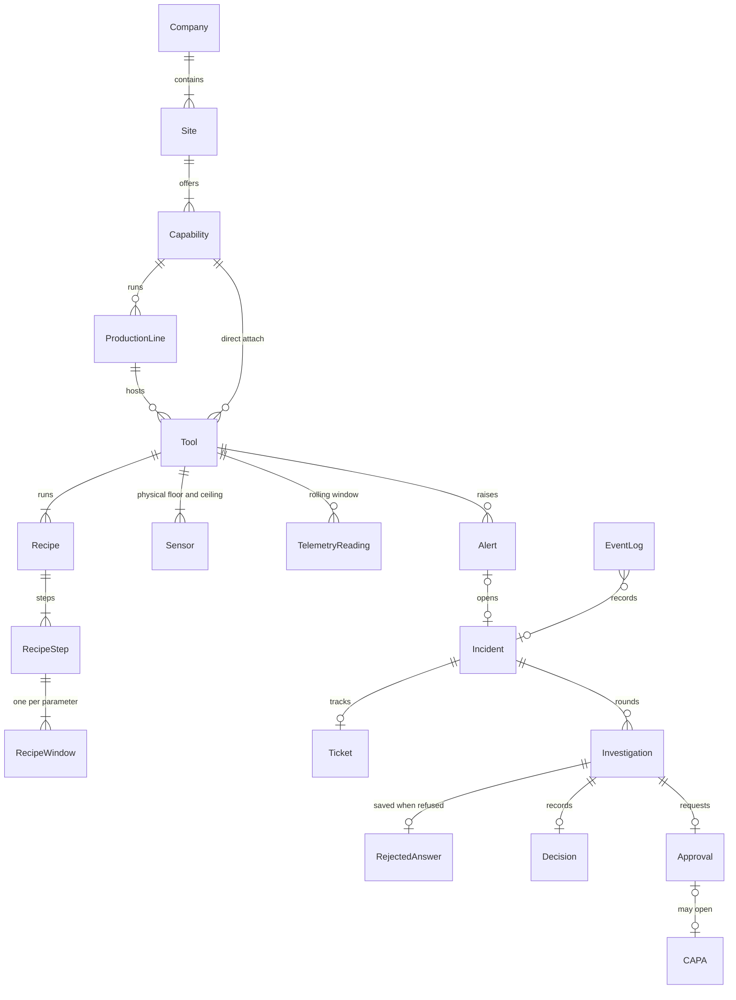

# Data model

Copyright (c) 2026 Bryan C. Weis and Common Consulting Company

Plant metadata is durable and read-only at runtime. Transactional records are the live quality case. They live in one SQLite file with the event log and the telemetry table. A hard reset clears the transactional records and the telemetry table. A soft reset closes open work and keeps the stored telemetry. Neither reset reads or deletes metadata. See ADR-009.

The diagram shows the records the console joins. Recipe windows and sensor ranges live in the fleet files, not in a table. Evidence, hypotheses, the matrix, the human decision, and the rejected answer are JSON on the investigation row.

## Metadata

A company has a name, a purpose, a description, and an industry. Each site belongs to that company. A site has capabilities. The capability types are manufacturing, warehousing, research and development, sales, back office, and other. Only manufacturing is simulated.

A production line belongs to a manufacturing capability. The end-to-end line is an ordered list of step lines: photoresist strip, clean, thin-film deposition, then wafer etch. Tools sit on a step line, or they attach directly to the manufacturing capability and have no line.

A tool catalog row lists inputs, outputs, and parameters. On that row, `lcl` and `ucl` are the family envelope: the lowest and highest value the sensor can physically read. `alertLow`, `alertHigh`, and `nominal` sit inside that envelope. Those numbers are not the chart's control limits.

A business rule has an order, a condition, and actions. The first match wins, lowest order first. Scenarios, faults, and commands are YAML catalogs. They are not tables.

## Recipe windows

Each simulated tool has recipes. Each recipe has steps. Every step defines every parameter the tool measures. A step that does not actively control a parameter still has a window for it, marked idle. A check when the fleet loads refuses a step that leaves a parameter out. Nothing falls back to another step's window or to the sensor range.

The spec for a reading is the minimum and maximum of the recipe window for the step running at that time. Control limits are that window's center plus or minus three standard deviations of the window (the window width divided by six), then clamped to the sensor's physical floor and ceiling. The same clamp is used on the server, on the chart, and in the rule score. During a fault the band keeps following the recipe step. It does not re-center on the bad readings.

The live series does not store those limits as rows. `segments` on a live series is one segment per recipe step in the charted points. Each segment carries the recipe name, the step name, the idle flag, the center, the sigma, and the physical floor and ceiling.

## Transactional records

`Tools` and `Chambers` are the fleet rows copied into the database so alerts can point at them. `Alert` is one statistical or reported signal on a tool, with a rule, a severity, a raised time, a last-seen time, an occurrence count, and a cleared time. `Incident` is the open case for one tool and parameter. `Ticket` is the work item for that case. Ticket numbers come from `TicketSequences`.

`Investigation` is one round of that case. The round number is `Sequence` (1 for the first run, then one more each time a person adds evidence). `EvidenceJson`, `HypothesesJson`, and `EvidenceMatrixJson` hold the pack. `DecisionJson` holds the human decision once someone approves, overrides, rejects, or adds evidence. `RejectedAnswerJson` holds the cause, class, and cited evidence ids the model proposed when a guard refused the answer. The API returns that as `rejectedAnswer` only while the round is escalated. It is null when no answer was refused.

A person can add evidence and start another round, up to the cap in `data/metadata/investigation.yaml` (`evidenceRounds.max`, 5). At the last round only approve, override, or reject remain. Adding evidence closes the round as superseded. The next round is a new investigation row.

While a round is gathering, the server streams a Started placeholder that is not saved yet. The tool's linked-records list keeps one entry for that round: when the saved investigation arrives, it replaces the placeholder.

`Approval` is the signed decision on an investigation. A `CAPA` opens only after an approval, and never straight from an escalated investigation. `Fault` is an accepted injected fault. `MetricSamples` records one investigation's grounding, tool calls, latency, and cost.

`eventlog` is the ordered story of a case. Telemetry events are not copied into it. `telemetry` keeps readings. `JoinLinks` and `DemoMembers` are the guest-join rows in the same file.

Manual bench readings are kept in memory and enter the same series as the sensor. They are not a table. They also appear in that tool's linked records, with the tickets, alerts, and investigations.

Rule text is recorded on the alert and in the trace. It is not a column on the incident row.

## Telemetry window

Each sensor keeps the newest 600 readings. That count is `telemetryWindow.readingsPerSensor` in `data/metadata/simulation.yaml`. The in-memory series and the `telemetry` table both roll off older readings. The chart's horizontal axis is always this wide (`windowPoints`). New readings enter on the right and old ones leave on the left.

A hard reset deletes transactional rows and the telemetry table, then the plant primes one window of healthy readings in memory. That prime does not go through the event bus. Reset does not seed a week of history. A soft reset closes open work and keeps the telemetry already stored, including active alerts. It restarts the in-memory window with the same prime, which also does not go through the event bus.

The SPC rule engine is in memory: one ring and a few counters per tool, chamber, and parameter. It is not a table. On startup, and after a hard reset, a soft reset, a scenario stop, or a fault clear, that memory is rebuilt from active rows in `Alert` and the rings start empty. An alert then clears only when later readings satisfy the hysteresis in `data/metadata/spc-rules.yaml`. A reset does not mark alerts cleared by itself. A hard reset has already deleted them, so the rebuild sees an empty store.
