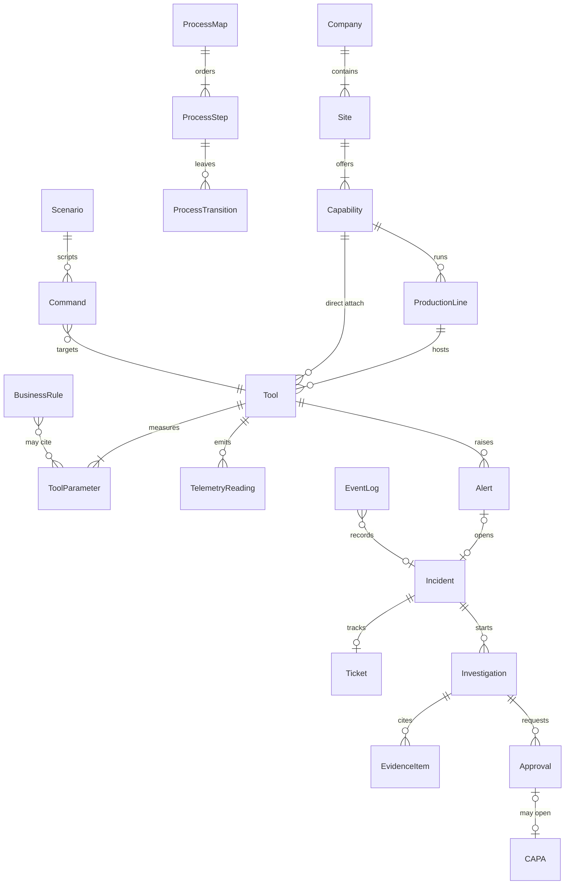

# Data model

Copyright (c) 2026 Bryan C. Weis and Common Consulting Company

Plant metadata is durable and read-only at runtime. Transactional records are the live quality case. They live in the transactional database. Reset clears the transactional records and does not read or delete metadata. See ADR-009.

The diagram shows both sides. This lane stores the metadata side in `data/metadata` and serves it from memory. The event bus lane owns the event log and the telemetry store. Those tables are not created here.

## Metadata

A company has a name, a purpose, a description, and an industry. Each site belongs to that company. A site has capabilities. The capability types are manufacturing, warehousing, research and development, sales, back office, and other. Only manufacturing is simulated.

A production line belongs to a manufacturing capability. The end-to-end line is an ordered list of step lines: photoresist strip, clean, thin-film deposition, then wafer etch. Tools sit on a step line, or they attach directly to the manufacturing capability and have no line. Each tool has inputs, outputs, and parameters. A telemetry parameter has a lower limit, an upper limit, alert thresholds, and a nominal value.

A business rule has an order, a condition, and actions. The first match wins. A process map is either current or future. Each step can name the incident stages that light it up on the rules page.

## Transactional records

`TelemetryReading` is one sample from a tool. `EventLog` is the ordered story of a case. `Alert` is a statistical or reported signal. `Incident` is the case. `Ticket` is the work item for that case. `Investigation` gathers `EvidenceItem` rows and may ask for an `Approval`. A `CAPA` opens only after that approval, and never straight from an escalated investigation. `Scenario` is a scripted story. `Command` is one scripted action aimed at a tool.

Rule identity is recorded on the decision for the request and on the trace. It is not a new column on the incident row, so reset and the event bus lane do not have to migrate that table.
