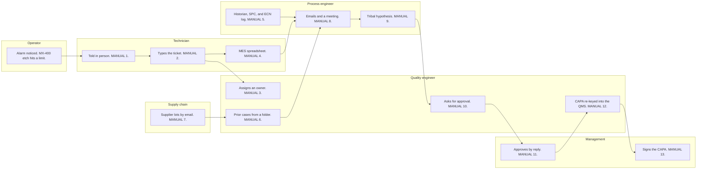

# As-is investigation flow

**Issue:** G5 (#74)
**Copyright (c) 2026 Bryan C. Weis and Common Consulting Company**

Meridian Precision Systems Quality and Engineering Issue Resolution. This is a StatusNeo reading of the **current** investigation process: what people do today, before an assisted evidence pack. The customer, the tool, and the durations are fictional. Every duration on the print sheet is marked **illustrative / simulated**.

The worked example is one alarm on the **MX-400 etch**, a fictional etch tool. The path is the one a process engineer would recognize: an alarm, a phone call, a ticket typed into email, spreadsheet exports from separate systems, a meeting, a hypothesis from the last similar alarm, a reply-all approval, and a corrective and preventive action re-keyed by hand.

The assisted path is the G4 sheet, [`investigation-flow.md`](investigation-flow.md). The side-by-side comparison is `print/as-is-vs-to-be-archD.pdf`. The consultative note is [`../analysis/current-vs-future-state.md`](../analysis/current-vs-future-state.md).

## Diagram

Red **MANUAL** badges and red arrows on the print sheet are the hand-offs. Amber **ERROR RISK** badges are the places a fact can change. Mermaid cannot carry those badges. The plotter file does.

## Stage bands

The bands across the top are elapsed time for this simulated incident, not labor hours. Detect through Diagnose sums to the **4.0-day** simulated time to a root-cause hypothesis in PLAN section 6.5. The split inside those 4.0 days is illustrative. CAPA at **62 days** is the simulated record cycle from the same section, not part of the 4.0 days. Decide / approve at **2.0 days** is an illustrative slice of the days after the hypothesis. The ROI model does not shrink those days.

| Stage | Simulated duration | Manual hand-offs | What happens |
|---|---|---|---|
| Detect | 0.5 day | 1 | The operator notices the alarm and tells a technician in person. |
| Triage | 0.5 day | 2 | The technician types a ticket into email. The quality engineer assigns an owner by reply. |
| Gather evidence | 2.0 days | 5 | Run sheet, historian, control charts, the change log, prior cases, and supplier lots leave as files. A meeting compares them. |
| Diagnose | 1.0 day | 1 | The process engineer states the last known cause. |
| Decide / approve | 2.0 days | 2 | Approval is a meeting or a mail reply. No evidence pack is attached. |
| CAPA | 62 days | 2 | The quality engineer re-keys the story. Management signs it. |
| Detect through Diagnose | 4.0 days | 9 | Simulated time to a hypothesis. |
| All stages |  | 13 | Every red badge on the sheet. |

## Lanes

| Lane | Colour on the print sheet | What this person does today |
|---|---|---|
| Operator | Teal | Sees the alarm on the tool. Notes the chamber and the recipe. Does not open a ticket. |
| Technician | Orange | Takes the verbal report, types the ticket, and exports the manufacturing run sheet. |
| Process engineer | Blue | Copies the historian, the control chart, and the engineering-change log. Runs the meeting. States the hypothesis. |
| Quality engineer | Slate | Names an owner, forwards prior cases, asks management, and re-keys the record. |
| Supply chain | Gold | Looks up the supplier lot and emails it. The lot is not joined to the run. |
| Management | Green | Approves by reply and later signs the record. Does not see the source files. |

## Steps

| Step | Lane | Badge | Error risk |
|---|---|---|---|
| Alarm noticed. MX-400 etch hits a limit. | Operator |  |  |
| Told in person. Nothing is written yet. | Technician | MANUAL 1 | E1 Spoken alarm |
| Types the ticket. Email is the record. | Technician | MANUAL 2 | E2 Ticket retyped |
| Assigns an owner by reply-all. | Quality engineer | MANUAL 3 | E3 Data gap |
| Manufacturing run sheet exported, then emailed. | Technician | MANUAL 4 | E4 Spreadsheet paste |
| Historian, statistical process control chart, and engineering-change log copied out. | Process engineer | MANUAL 5 | E5 Missed engineering change |
| Prior cases pulled from a folder. | Quality engineer | MANUAL 6 | E6 Data gap |
| Supplier lots looked up, then emailed. | Supply chain | MANUAL 7 | E7 Wrong lot traced |
| Emails and a meeting. Spreadsheets compared live. | Process engineer | MANUAL 8 | E8 Data gap |
| Tribal hypothesis. The last alarm was the chamber. | Process engineer | MANUAL 9 | E9 Bias toward the last known cause |
| Asks for approval. No evidence pack attached. | Quality engineer | MANUAL 10 |  |
| Approves by reply. The cause is not cited. | Management | MANUAL 11 | E10 Uncited approval |
| Corrective and preventive action written by hand into the quality system. | Quality engineer | MANUAL 12 | E11 Re-keyed record |
| Signs the record. Does not see the files. | Management | MANUAL 13 |  |

The systems named on the sheet are the manufacturing execution system (MES), the historian, statistical process control (SPC), the engineering-change notice log (ECN), supplier lots, and the quality management system (QMS). People reach them by export and email. There is no shared evidence pack.

## Narrative

The operator is the first person who knows. The MX-400 etch has hit a limit. The operator writes the chamber and the recipe on a note or says them to the technician. That sentence is the first record, and it is not in a system. MANUAL 1 is that conversation. E1 is the transcription that follows: the chamber name is heard, then written later.

The technician types a ticket into email: tool, time, and symptom. MANUAL 2. E2 is the retype. The quality engineer assigns an owner by reply-all. MANUAL 3. E3 is the data gap: the recipe step or the chamber is the field the reply drops.

Gathering evidence is five hand-offs and most of the four days. The technician exports the manufacturing run sheet and emails the spreadsheet. MANUAL 4. E4 is the paste into that sheet. The process engineer copies three more files: historian traces, the control chart, and the engineering-change log, which is a separate scroll checked by eye. MANUAL 5. E5 is the missed engineering change. The quality engineer pulls prior cases from a folder and forwards them. MANUAL 6. E6 is that folder: the cases are not on the ticket. Supply chain looks up the supplier lot and emails it. MANUAL 7. E7 is the wrong lot: the supplier lot is not joined to the run lot. Those files meet in email and on a call. MANUAL 8. E8 is the meeting itself: nobody records which file was the current one.

The hypothesis is tribal knowledge. The last similar alarm was a dirty chamber, so this one is stated the same way. MANUAL 9. E9 is bias toward the last known cause. The four cause classes are not checked as a set.

Approval is a meeting or a mail reply. The quality engineer asks. MANUAL 10. Management approves. MANUAL 11. E10 is the uncited approval: there is no evidence pack, so the signature cannot point at a file. The quality engineer then re-keys the narrative, the lot, and the actions into the quality system. MANUAL 12. E11 is that second copy. The spreadsheets stay in the mail thread. Management signs the record. MANUAL 13. The signer does not see the files.

Thirteen red badges. Eleven amber badges. The print sheet's callout box is the legend for E1 through E11.

## Glossary on the sheet

| Short form | Plain expansion |
|---|---|
| MES | manufacturing execution system |
| SPC | statistical process control |
| ECN | engineering change notice |
| QMS | quality management system |
| CAPA | corrective and preventive action |

Historian, supplier lot, and the MX-400 etch are already plain words. The sheet does not abbreviate them.

## Large-format print

ARCH D sheet (36 by 24 in, landscape), **v1.0**, 2026-10-14. The mermaid block above is the review source. The plotter file is hand-composed so labels do not cross.

- [`print/as-is-flow-archD.pdf`](print/as-is-flow-archD.pdf)
- [`print/as-is-flow-archD.svg`](print/as-is-flow-archD.svg)
- [`print/as-is-flow.svg`](print/as-is-flow.svg)

Regenerate with `pwsh docs/diagrams/render.ps1 -- --only as-is-flow`. See [`README.md`](README.md).
