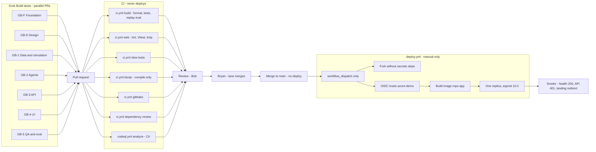

# CI/CD and promotion

**Issue:** G3 (#48)
**Copyright (c) 2026 Bryan C. Weis and Common Consulting Company**

How a change reaches the Meridian Precision Systems demo. Parallel Grok Build lanes open pull requests. CI must pass. Bob reviews. Merge to `main` does not deploy. `deploy.yml` is a manual, environment-gated workflow. Smoke runs after deploy.

Logical view: [`logical.md`](logical.md). Physical view: [`physical.md`](physical.md).

## Diagram

## Gates

| Stage | What blocks progress | What it must not do |
|---|---|---|
| Lanes | Each lane is a branch and a PR. P0 (GB-F, with GB-D) lands before the P1 lanes build on frozen contracts. At most five Grok Build sessions at once. | Agents do not call git remotes. Bob syncs with `sync_to_github.ps1`. |
| `ci.yml` | Jobs: `build` (warnings as errors, `dotnet format --verify-no-changes`, tests except `Category=Slow`, replay eval, coverage report uploaded), `web` (ESLint, Vitest, production build, knip), `slow tests`, `bicep` (compile only), `gitleaks`, `dependency review` (pull requests). | CI does not deploy and does not receive Azure credentials. It does not fail on a coverage percent. |
| `codeql.yml` | Job `analyze`. It builds the solution and analyzes C#. | It does not deploy. |
| `quality.yml` | Nightly and on demand. Coverage report and a mutation run. | It is not a pull-request check. |
| Review | Bob reviews. Bryan approves lane merges. The intended branch protection on `main` is a pull request, green CI, and review. | A lane does not merge itself. Agents do not run git commands that contact GitHub. Bob syncs with `sync_to_github.ps1`. |
| `main` | Integration branch. Still no Azure changes. | A push to `main` does not run a deploy. |
| `deploy.yml` | Manual `workflow_dispatch` only. Environment `azure-demo`. OpenID Connect, no stored cloud client secret. A fork without the secrets and variables skips. The workflow builds `mps-app` and deploys one replica. There is no Bicep what-if step. | It does not run on push or merge. It is one deploy per batch, and not while Bryan is testing the live demo. A deploy wipes the demo SQLite data. |
| Smoke | `/health` is 200, an anonymous `/api/tools` is 401, and `/` redirects to `/landing.html`. | Smoke is not a substitute for the eval gates. |

The GitHub environment name is `azure-demo`, which is the name in `deploy.yml` and on the federated credential.

## Large-format print

ARCH D sheet (36 × 24 in, landscape), v1.0, 2026-10-14:

- [`print/cicd-archD.pdf`](print/cicd-archD.pdf)
- [`print/cicd-archD.svg`](print/cicd-archD.svg)
- [`print/cicd.svg`](print/cicd.svg)

Regenerate with `pwsh docs/diagrams/render.ps1`. See [`README.md`](README.md).
