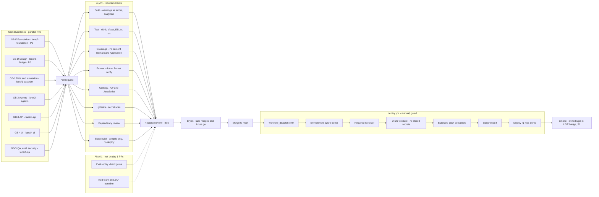

# CI/CD and promotion

**Issue:** G3 (#48)
**Copyright (c) 2026 Bryan C. Weis and Common Consulting Company**

How a change reaches the Meridian Precision Systems demo. Parallel Grok Build lanes open pull requests. CI must pass. Bob reviews. Merge to `main` does not deploy. `deploy.yml` is a manual, environment-gated workflow. Smoke runs after deploy.

Logical view: [`logical.md`](logical.md). Physical view: [`physical.md`](physical.md).

## Diagram

## Gates

| Stage | What blocks progress | What it must not do |
|---|---|---|
| Lanes | Each lane is a branch and a PR. P0 (GB-F, with GB-D) lands before the P1 lanes build on frozen contracts. At most five Grok Build sessions at once. | Agents do not call git remotes. Bob syncs with `sync_to_github.ps1`. |
| `ci.yml` | Build (warnings as errors, analyzers), test (xUnit, Vitest, ESLint, tsc), coverage at or above 70% on Domain and Application, `dotnet format --verify-no-changes`, CodeQL (C# and JavaScript), gitleaks, dependency review, Bicep build. | CI does not deploy and does not receive Azure credentials. |
| Later checks | Eval in replay mode with hard gates, promptfoo red-team, and the OWASP ZAP baseline. They arrive with integration (I1) and SEC1, then stay on PRs. | A day-1 scaffold PR is not failed for an eval suite that does not exist yet. |
| Review | Bob is the required reviewer. SPEC also has Bryan approve lane merges. Branch protection on `main`: PR, green CI, review. | A lane does not merge itself. |
| `main` | Integration branch. Still no Azure changes. | A push to `main` does not run a deploy. |
| `deploy.yml` | Manual `workflow_dispatch`. GitHub environment `azure-demo` with a required reviewer. OIDC federation, no stored cloud secrets. Build and push images, Bicep what-if, then deploy `rg-mps-demo`. | It does not run on an unreviewed PR, and it does not use a client secret in the repo. |
| Smoke | Invited guest can sign in. LIVE AI badge and spend meter show. Scenario S1 runs in replay, then live. An uninvited account is blocked. | Smoke is not a substitute for the eval hard gates. |

The operator brief for this sheet names the GitHub environment `azure-demo`. PLAN.md §10 and [`physical.md`](physical.md) call that environment `demo`. This diagram uses `azure-demo` until Bob confirms the name on the federated credential.

## Large-format print

ARCH D sheet (36 × 24 in, landscape), v1.0, 2026-10-14:

- [`print/cicd-archD.pdf`](print/cicd-archD.pdf)
- [`print/cicd-archD.svg`](print/cicd-archD.svg)
- [`print/cicd.svg`](print/cicd.svg)

Regenerate with `pwsh docs/diagrams/render.ps1`. See [`README.md`](README.md).
