# Investigation flow

**Issue:** G4 (#56)
**Copyright (c) 2026 Bryan C. Weis and Common Consulting Company**

Meridian Precision Systems Quality & Engineering Issue Resolution. This is the **end-to-end investigation swimlane**: who acts at each step from Alerts / Tickets through Investigation, Approval, and CAPA (corrective and preventive action). The logical boxes are in [`logical.md`](logical.md). This drawing is the screen order Bryan asked to see, with every agent step marked.

Thesis from SPEC: engineers decide; AI assembles and reasons over evidence; rules enforce. The model never holds write authority. Unsupported answers escalate. They are not filled in.

SPEC 2.10 adds the plain-language layer a non-manufacturing reader needs. This sheet shows where each piece is produced:

- The **tool schematic** is the evidence entry point, on the console, before triage.
- **Why-lines** are written by the Investigation Agent, one plain sentence on each evidence item, before the evidence gate.
- The **evidence matrix** is written by the Resolution Agent when it ranks causes. Four classes, the signal that supports each one, and the signal that rules it out.
- **Glossary plain language** is a property of the console. Every screen spells a term on first use. The glossary box on the sheet expands the acronyms the swimlane still uses.

## Diagram

```mermaid
flowchart LR
  subgraph HUM["Engineer / Human"]
    direction TB
    HOPEN["Opens the ticket. No write yet."]
    HESC["No root cause. Named gaps only."]
    HAPR["HUMAN APPROVAL gate. Signed token."]
  end

  subgraph CON["Console screen. Glossary plain language."]
    direction TB
    CALERT["Alerts, then Tickets"]
    CSCH["Tool schematic. Evidence entry point."]
    CESC["Request info. Missing or contradictory."]
    CAPR["Approval screen. Explicit confirm."]
    CCAPA["CAPA screen. Corrective and preventive action."]
  end

  subgraph DET["Deterministic services"]
    direction TB
    SPC["SPC alert. Statistical process control. Opens a ticket."]
    GATE["Evidence gate. Sufficiency and contradiction."]
    GROUND["Grounding check. Each why-line cites a real item."]
    ACT["Action service. Token required. Not an agent tool."]
  end

  subgraph INV["Investigation Agent"]
    direction TB
    TRI["Triage. AGENT. Plans the pack. Does not diagnose."]
    HYP["Hypotheses. AGENT. Names four classes. Does not pick one."]
    CALLS["Tool calls. AGENT. Read-only. At most 10."]
    WHY["Why it matters. AGENT. One plain line per evidence item."]
  end

  subgraph RES["Resolution Agent"]
    direction TB
    RANK["Rank causes. AGENT. Writes the evidence matrix."]
    DRAFT["CAPA draft. AGENT. Actions only. Not a write."]
  end

  subgraph TOOL["Tools / enterprise systems"]
    direction TB
    READ["MES, QMS, PLM, ERP, CMMS, documents. Read-only."]
    QMS["Quality system create. 500, timeout, or 409."]
  end

  subgraph MOD["Model gateway"]
    direction TB
    GTRI["Model call for triage. Ledger and daily cap."]
    GRANK["Model call for ranking. At most two calls."]
  end

  SPC --> CALERT --> HOPEN --> CSCH --> TRI
  TRI --> GTRI
  TRI --> HYP --> CALLS --> READ --> WHY --> GATE
  GATE -->|missing or contradictory| CESC --> HESC
  GATE -->|sufficient| RANK --> DRAFT --> GROUND --> CAPR --> HAPR --> ACT
  RANK --> GRANK
  ACT --> QMS
  ACT --> CCAPA

  classDef agent fill:#F3EEFF,stroke:#6D28D9,color:#111827
  classDef rules fill:#E7F8FB,stroke:#0E7490,color:#111827
  classDef human fill:#E7F7F4,stroke:#0F766E,color:#111827
  classDef screen fill:#FFFFFF,stroke:#334155,color:#111827
  classDef tools fill:#F1F5F9,stroke:#475569,color:#111827
  classDef gateway fill:#FFF6D8,stroke:#A16207,color:#111827
  class TRI,HYP,CALLS,WHY,RANK,DRAFT agent
  class SPC,GATE,GROUND,ACT rules
  class HOPEN,HESC,HAPR human
  class CALERT,CSCH,CESC,CAPR,CCAPA screen
  class READ,QMS tools
  class GTRI,GRANK gateway
```

The evidence matrix is drawn under the swimlane on the print sheet, with an arrow from Rank causes. Mermaid cannot hold that table, so the matrix is specified in the section below and on the plotter file.

## Lanes

| Lane | Colour on the print sheet | What it may do |
|---|---|---|
| Engineer / Human | Teal | Open the ticket, own an escalation, approve or reject. The only accountable actor. |
| Console screen | White | Alerts, Tickets, the tool schematic, Investigation, Approval, CAPA. Glossary plain language on every screen. Shows state. Does not decide. |
| Deterministic services | Cyan | Statistical process control, evidence gate, grounding validator, signed-token check, action service. Unit tested. |
| Investigation Agent | Violet, **AGENT** badge | Triage, name the four classes, call read-only tools, write one why-line per evidence item. Cannot diagnose or write. |
| Resolution Agent | Violet, **AGENT** badge | Rank causes, write the evidence matrix, draft CAPA actions. No tools. Cannot write. |
| Tools / enterprise systems | Slate | Manufacturing, quality, product-lifecycle, and planning systems, plus maintenance and document retrieval. Read-only until the action service calls the mock quality system. |
| Model gateway | Gold | Completions, retries, cost ledger, daily spend cap. Not a decision. |

Screen order on the sheet, left to right: **Alerts / Tickets → Investigation → Approval → CAPA**.

## Steps

| Step | Lane | Agent? | Screen |
|---|---|---|---|
| Statistical process control alert opens a ticket | Deterministic | No | Alerts / Tickets |
| Console shows the alert and the ticket | Console | No | Alerts / Tickets |
| Engineer opens the ticket | Engineer | No | Alerts / Tickets |
| Tool schematic, the evidence entry point | Console | No | Investigation |
| Triage | Investigation Agent | **Yes** | Investigation |
| Hypothesis generation, four classes, no pick | Investigation Agent | **Yes** | Investigation |
| Evidence tool calls | Investigation Agent, then tools | **Yes** (the agent) | Investigation |
| Why it matters, one plain line per evidence item | Investigation Agent | **Yes** | Investigation |
| Evidence gate | Deterministic | No | Investigation |
| Escalation path | Console, then engineer | No | Investigation |
| Rank causes, which writes the evidence matrix | Resolution Agent | **Yes** | Investigation |
| CAPA draft | Resolution Agent | **Yes** | Investigation |
| Grounding validation, including each why-line | Deterministic | No | Investigation |
| Human approval, signed token | Engineer, on the Approval screen | No | Approval |
| Create the record in the mock quality system | Action service, then the quality system | No | CAPA |

The violet **AGENT** badge is on triage, hypotheses, tool calls, why-lines, ranking, and the CAPA draft. The **HUMAN** badge is only on the approval gate. A dashed rust arrow is the escalation branch. It does not continue into ranking.

## Narrative

An alert that clears the severity threshold is raised by **statistical process control** (SPC on the sheet) using Western Electric rules, not by a model. The rules **open a ticket**. The console moves from Alerts to Tickets and the lifecycle bar advances. The engineer opens the ticket. Nothing has been written to the quality system.

The console then opens the **tool schematic**. This is the evidence entry point for a reader who does not live in the fab. SPEC 2.10 calls for one picture per tool family (deposition, etch, strip, clean) with the chamber, radio-frequency source, gas box and flow controllers, vacuum and pump, chuck and heater, and the wafer handler. Each sensor point shows the live value, the unit, and a status color, and opens its control chart. The card on the sheet names the chamber, gas, vacuum, chuck, and radio-frequency source, and says a sensor opens its chart. Heater and wafer handler are the same picture; the card does not have a sixth line. Sensor identity, type, and unit come from the fleet spec when that catalog exists (`sensors` with `id`, `type`, `unit`, `subsystem`, `schematicAnchor`). The schematic does not decide a cause. It is where the evidence starts.

The **Investigation Agent** triages next. It plans which evidence to collect. It does not name a root cause. The call goes through the **model gateway** (route, retry, cost ledger, daily cap). Over the cap, or in the local default, the gateway serves replay instead of a live model.

The same agent then **names four hypothesis classes** and does not pick one. The classes are fixed by SPEC §2.4 and SPEC 2.10. The sheet keeps the names short. The matrix, not the hypothesis card, carries the signals.

| Class on the sheet | SPEC name | What the evidence would show |
|---|---|---|
| Engineering change | Engineering change | A product-lifecycle change order changed a recipe step or a part shortly before onset, and only the affected recipe or tool moved. Maintenance the same week is the usual confounder. |
| Out of spec | Equipment out of spec, calibration, or alignment | Maintenance records show an overdue calibration, alignment drift, or a maintenance gap. The signal sits on one chamber. A new material lot that week is the usual confounder. |
| Supply-chain material | Supply-chain material | Planning records show a new lot of gas, target, chemical, or wafers. The shift spans the tools that used that lot. A change order on one of those tools is the usual confounder. |
| Process drift | Process drift | A gradual ramp that tracks chamber radio-frequency hours since the last clean, or consumable wear. No discrete event. Ordinary seasonal noise is the usual confounder. |

Deterministic **impact features** (scope of one chamber, one tool, a recipe, or a lot; timing against events; signal shape) are computed in code and handed to the agent as features. The agent does not invent them.

**Tool calls** are read-only and capped at ten: telemetry window, control-chart violations, manufacturing runs and lots, quality nonconformances, change orders and config, material lots and supplier notices, work orders and calibrations, document retrieval, and impact scope. The tools lane is those enterprise systems and the document store. The agent cannot add a write tool. Ground truth from the fault injector is not in this lane.

When the reads return, the Investigation Agent writes **why it matters**: one plain sentence on every evidence item, stored on the pack. The SPEC example is "Chamber temperature drifted 4 °C above spec, which can change etch depth." The line says what the signal does to the wafer. It does not name the winning cause. The field the agents must emit is `whyItMatters`. It is not in the frozen `contracts-v1` schemas yet. See the design question.

The **evidence gate** is code. It checks sufficiency and contradiction (counts, timestamps, config conflicts such as a product-lifecycle revision that disagrees with the manufacturing run header). Two exits:

- **Sufficient.** The pack, including the why-lines, goes on to the Resolution Agent.
- **Missing or contradictory.** The dashed path. The console shows Request info with the exact gaps, in glossary plain language. The engineer owns the gap. **No root cause is asserted.** The Resolution Agent is not called. This is scenario S2.

The **Resolution Agent** has no tools. It only sees the evidence pack. It **ranks** a category and a specific cause, with confidence, citation ids, and the confounder addressed rather than ignored. On this sheet that rank step **writes the evidence matrix**:

| Root-cause class | Signals that support it | Signals that rule it out |
|---|---|---|
| Engineering change | A change order just before the shift, and only those tools moved | Maintenance the same week |
| Out of spec | Overdue calibration or alignment, on one chamber | A new material lot that week |
| Supply-chain material | A new lot of gas, chemical, or wafers on every tool that used it | A change order on one of those tools |
| Process drift | A slow ramp that tracks hours since the chamber was cleaned | Ordinary seasonal noise |

The "rules it out" column is the confounder from SPEC §2.4: the signal that can explain the same shift without that class being the cause. The agent must cite it, not drop it.

On the same output the agent **drafts corrective and preventive actions** (containment, corrective action). The draft is text. It is not a quality-system write. SPEC §2.5 caps this agent at two model calls, through the gateway, with structured output.

The sheet draws ranking (and the matrix it writes), then the CAPA draft, then the grounding check. That follows SPEC: the agent finishes one payload, and only then does the validator run. The draft is its own marked step so it is obvious the agent proposed it. The validator still sees it.

The **grounding validator** is code. Every cited id must be in the pack. Every cited why-line must point at a real evidence item. Uncited claims, unknown ids, and a why-line that cites nothing in the pack are rejected. A failed check does not become a softer recommendation.

The engineer sees the grounded recommendation on the **Approval screen** and must explicitly confirm or reject. Confirm mints a single-use signed approval token, bound to the action hash, expiring. Reject mints nothing. The token is checked in the adapter and again in the API. The **action service** is the only caller of the mock quality system's create operation. The mock can return 500, timeout, or 409; the service retries or returns the failed state. It does not ask the model to invent a record number. The **CAPA screen** then shows the new record and the lifecycle bar advances. The screen spells the name: corrective and preventive action.

Agents are never registered with write tools. That is an architecture test, not a prompt instruction.

## Glossary on the sheet

The console lane is labeled **Glossary plain language**. Terms are spelled on first use on each screen. The print sheet keeps a few short forms inside the swimlane and expands them in the glossary box:

| Short form | Plain expansion |
|---|---|
| SPC | statistical process control |
| CAPA | corrective and preventive action |
| MES | manufacturing execution system |
| QMS | quality management system |
| PLM | product lifecycle management |
| ERP | enterprise resource planning |
| CMMS | maintenance system for work orders |

The signed approval token is spelled on the approval card. The sheet does not use an unexplained hash acronym. Radio frequency is spelled on the schematic card. The ranking model and the structured output are named in this note; the card says "Ranking route" and "At most two calls."

## Large-format print

ARCH D sheet (36 × 24 in, landscape), **v1.1**, 2026-10-14. The mermaid block above is the review source. The plotter file is hand-composed so labels do not cross. v1.1 adds the tool schematic, the why-line step, the evidence matrix, the console glossary line, and the glossary box.

- [`print/investigation-flow-archD.pdf`](print/investigation-flow-archD.pdf)
- [`print/investigation-flow-archD.svg`](print/investigation-flow-archD.svg)
- [`print/investigation-flow.svg`](print/investigation-flow.svg)

Regenerate with `pwsh docs/diagrams/render.ps1 -- --only investigation-flow`. See [`README.md`](README.md).
