# Investigation flow

**Issue:** G4 (#56)
**Copyright (c) 2026 Bryan C. Weis and Common Consulting Company**

Meridian Precision Systems Quality & Engineering Issue Resolution. This is the **end-to-end investigation swimlane**: who acts at each step from Alerts / Tickets through Investigation, Approval, and CAPA. The logical boxes are in [`logical.md`](logical.md). This drawing is the screen order Bryan asked to see, with every agent step marked.

Thesis from SPEC: engineers decide; AI assembles and reasons over evidence; rules enforce. The model never holds write authority. Unsupported answers escalate. They are not filled in.

## Diagram

```mermaid
flowchart LR
  subgraph HUM["Engineer / Human"]
    direction TB
    HOPEN["Opens the ticket. No write yet."]
    HESC["No root cause. Named gaps only."]
    HAPR["HUMAN APPROVAL gate. ApprovalToken."]
  end

  subgraph CON["Console screen"]
    direction TB
    CALERT["Alerts, then Tickets"]
    CESC["Request info. Missing or contradictory."]
    CAPR["Approval screen. Explicit confirm."]
    CCAPA["CAPA screen"]
  end

  subgraph DET["Deterministic services"]
    direction TB
    SPC["SPC alert. Western Electric. Opens a ticket."]
    GATE["Evidence gate. Sufficiency and contradiction."]
    GROUND["Grounding validation. Cited IDs must be in the pack."]
    ACT["Action service. Token required. Not an agent tool."]
  end

  subgraph INV["Investigation Agent"]
    direction TB
    TRI["Triage. AGENT. Plans the pack. Does not diagnose."]
    HYP["Hypotheses. AGENT. Engineering change. Equipment out of calibration. Bad material lot. Process drift."]
    CALLS["Tool calls. AGENT. Read-only. At most 10."]
  end

  subgraph RES["Resolution Agent"]
    direction TB
    RANK["Rank causes. AGENT. Confidence, citations, counterEvidence."]
    DRAFT["CAPA draft. AGENT. Actions only. Not a write."]
  end

  subgraph TOOL["Tools / enterprise systems"]
    direction TB
    READ["MES, QMS, PLM, ERP, CMMS, document retrieval. Read-only."]
    QMS["Mock QMS CreateCapa. 500, timeout, or 409."]
  end

  subgraph MOD["Model gateway"]
    direction TB
    GTRI["Model call for triage. Ledger and daily cap."]
    GRANK["Model call for ranking. Schema JSON. At most two calls."]
  end

  SPC --> CALERT --> HOPEN --> TRI
  TRI --> GTRI
  TRI --> HYP --> CALLS --> READ --> GATE
  GATE -->|missing or contradictory| CESC --> HESC
  GATE -->|sufficient| RANK
  RANK --> GRANK
  RANK --> DRAFT --> GROUND --> CAPR --> HAPR --> ACT
  ACT --> QMS
  ACT --> CCAPA

  classDef agent fill:#F3EEFF,stroke:#6D28D9,color:#111827
  classDef rules fill:#E7F8FB,stroke:#0E7490,color:#111827
  classDef human fill:#E7F7F4,stroke:#0F766E,color:#111827
  classDef screen fill:#FFFFFF,stroke:#334155,color:#111827
  classDef tools fill:#F1F5F9,stroke:#475569,color:#111827
  classDef gateway fill:#FFF6D8,stroke:#A16207,color:#111827
  class TRI,HYP,CALLS,RANK,DRAFT agent
  class SPC,GATE,GROUND,ACT rules
  class HOPEN,HESC,HAPR human
  class CALERT,CESC,CAPR,CCAPA screen
  class READ,QMS tools
  class GTRI,GRANK gateway
```

## Lanes

| Lane | Colour on the print sheet | What it may do |
|---|---|---|
| Engineer / Human | Teal | Open the ticket, own an escalation, approve or reject. The only accountable actor. |
| Console screen | White | Alerts, Tickets, Investigation, Approval, CAPA. Shows state. Does not decide. |
| Deterministic services | Cyan | SPC, evidence gate, grounding validator, ApprovalToken check, action service. Unit tested. |
| Investigation Agent | Violet, **AGENT** badge | Triage, name the four classes, call read-only tools. Cannot diagnose or write. |
| Resolution Agent | Violet, **AGENT** badge | Rank causes and draft CAPA actions. No tools. Cannot write. |
| Tools / enterprise systems | Slate | MES, QMS, PLM, ERP, CMMS, document retrieval. Read-only until the action service calls mock QMS. |
| Model gateway | Gold | Completions, retries, cost ledger, daily spend cap. Not a decision. |

Screen order on the sheet, left to right: **Alerts / Tickets → Investigation → Approval → CAPA**.

## Steps

| Step | Lane | Agent? | Screen |
|---|---|---|---|
| SPC alert opens a ticket | Deterministic | No | Alerts / Tickets |
| Console shows the alert and the ticket | Console | No | Alerts / Tickets |
| Engineer opens the ticket | Engineer | No | Alerts / Tickets |
| Triage | Investigation Agent | **Yes** | Investigation |
| Hypothesis generation, four classes | Investigation Agent | **Yes** | Investigation |
| Evidence tool calls | Investigation Agent, then tools | **Yes** (the agent) | Investigation |
| Evidence gate | Deterministic | No | Investigation |
| Escalation path | Console, then engineer | No | Investigation |
| Hypothesis ranking | Resolution Agent | **Yes** | Investigation |
| CAPA draft | Resolution Agent | **Yes** | Investigation |
| Grounding validation | Deterministic | No | Investigation |
| Human approval, ApprovalToken | Engineer, on the Approval screen | No | Approval |
| CreateCapa in mock QMS | Action service, then mock QMS | No | CAPA |

The violet **AGENT** badge is only on the five agent steps: triage, hypotheses, tool calls, ranking, CAPA draft. The **HUMAN** badge is only on the approval gate. A dashed rust arrow is the escalation branch. It does not continue into ranking.

## Narrative

An alert that clears the severity threshold is raised by **SPC windows and Western Electric rules**, not by a model. The rules **open a ticket**. The console moves from Alerts to Tickets and the lifecycle bar advances. The engineer opens the ticket. That starts the investigation. Nothing has been written to the QMS.

The **Investigation Agent** triages first. It plans which evidence to collect. It does not name a root cause. The call goes through the **model gateway** (route, retry, cost ledger, daily cap). Over the cap, or in the local default, the gateway serves replay instead of a live model.

The same agent then **names four hypothesis classes** and does not pick one. The classes are fixed by SPEC §2.4:

| Class | What the evidence would show |
|---|---|
| Engineering change | A PLM ECO changed a recipe step or a part shortly before onset, and only the affected recipe or tool moved. A PM the same week is the usual confounder. |
| Equipment out of calibration | CMMS shows an overdue calibration, alignment drift, or a PM gap. The signal sits on one chamber. A supplier lot change that week is the usual confounder. |
| Bad material lot | ERP shows a new lot of gas, target, chemical, or wafers. The shift spans the tools that used that lot. An ECO on one of those tools is the usual confounder. |
| Process drift | A gradual ramp that tracks chamber RF-hours since clean or consumable wear. No discrete event. Normal seasonal noise is the usual confounder. |

Deterministic **impact features** (scope of one chamber, one tool, a recipe, or a lot; timing against events; signal shape) are computed in code and handed to the agent as features. The agent does not invent them.

**Tool calls** are read-only and capped at ten: telemetry window, SPC violations, MES runs and lots, QMS NCRs, PLM ECOs and config, ERP material lots and supplier notices, CMMS work orders and calibrations, document retrieval, and `Impact.Scope`. The tools lane is MES, QMS, PLM, ERP, CMMS, and the document store. The agent cannot add a write tool. Ground truth from the fault injector is not in this lane.

The **evidence gate** is code. It checks sufficiency and contradiction (counts, timestamps, config conflicts such as a PLM rev that disagrees with the MES run header). Two exits:

- **Sufficient.** The pack goes on to the Resolution Agent.
- **Missing or contradictory.** The dashed path. The console shows Request info with the exact gaps. The engineer owns the gap. **No root cause is asserted.** The Resolution Agent is not called. This is scenario S2.

The **Resolution Agent** has no tools. It only sees the evidence pack. It **ranks** a category and a specific cause, with confidence, citation IDs, and `counterEvidence` (the confounder, addressed, not ignored). On the same output it **drafts CAPA actions** (containment, corrective action). The draft is text in the JSON. It is not a QMS write. SPEC §2.5 caps this agent at two model calls, through the gateway, schema-constrained.

The sheet draws ranking and the CAPA draft as two marked steps, then the grounding check. That follows SPEC: the agent finishes one payload (`category`, `cause`, `confidence`, `evidenceIds`, `counterEvidence`, `actions`), and only then does the validator run. The draft is visible so it is obvious the agent proposed it. The validator still sees it.

The **grounding validator** is code. Every cited ID must be in the pack. Uncited claims and unknown IDs are rejected. A failed check does not become a softer recommendation.

The engineer sees the grounded recommendation on the **Approval screen** and must explicitly confirm or reject. Confirm mints a single-use HMAC **ApprovalToken**, bound to the action hash, expiring. Reject mints nothing. The token is checked in the adapter and again in the API. The **action service** is the only caller of mock QMS `CreateCapa`. The mock can return 500, timeout, or 409; the service retries or returns the failed state. It does not ask the model to invent a CAPA number. The **CAPA screen** then shows the new record and the lifecycle bar advances.

Agents are never registered with write tools. That is an architecture test, not a prompt instruction.

## Large-format print

ARCH D sheet (36 × 24 in, landscape), v1.0, 2026-10-14. The mermaid block above is the review source. The plotter file is hand-composed so labels do not cross.

- [`print/investigation-flow-archD.pdf`](print/investigation-flow-archD.pdf)
- [`print/investigation-flow-archD.svg`](print/investigation-flow-archD.svg)
- [`print/investigation-flow.svg`](print/investigation-flow.svg)

Regenerate with `pwsh docs/diagrams/render.ps1`. See [`README.md`](README.md).
