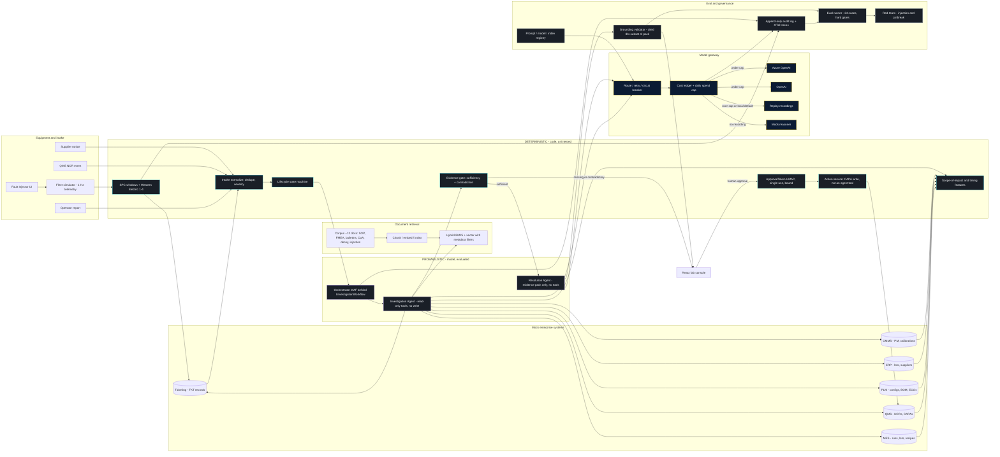

# Logical architecture

**Issue:** G1 (#46)
**Copyright (c) 2026 Bryan C. Weis and Common Consulting Company**

Meridian Precision Systems Quality & Engineering Issue Resolution. This is the **logical** view (what talks to what, and which side of the rules/AI/human boundary it sits on). Physical Azure layout is in [`physical.md`](physical.md).

Thesis from SPEC: engineers decide; AI assembles and reasons over evidence; **rules enforce**. Anything that must be repeatable, auditable, or safety-relevant is deterministic code. Models synthesize ambiguous evidence only, behind citation checks and a human ApprovalToken.

## Diagram

## Legend

| Band | Color in the console | What lives here | Write authority |
|---|---|---|---|
| **Deterministic** | Cyan | SPC / Western Electric, intake, lifecycle, impact features, evidence gate, ApprovalToken, CAPA action service | Yes, but only after a human token |
| **Probabilistic** | Violet | Investigation Agent, Resolution Agent, MAF graph behind `IInvestigationWorkflow` | None |
| **Model gateway** | Gold / navy (pitch) | Azure OpenAI, OpenAI, Replay, Mock reasoner, cost ledger, daily cap | None (completions only) |
| **Eval / governance** | Steel | Grounding validator, eval runner, red-team, audit log, version registry | None |
| **Mock enterprise** | Panel | MES, QMS, PLM, ERP, CMMS, ticketing | QMS CAPA write is the action service, not an agent tool |
| **Documents** | Panel | Seeded corpus, chunk/embed, hybrid retrieval with stable evidence IDs | Read-only |

## Narrative

Telemetry from the seeded fleet simulator (and live Fault Injector shapes) hits **SPC windows and Western Electric rules 1–4**. An alert above threshold **auto-creates a ticket**. Operator reports, QMS NCRs, and supplier notices join the same **intake** path: validate, dedupe against an open incident on the same tool/parameter, classify severity. The **lifecycle state machine** is the only legal way to move Alert → Ticket → Investigation → Recommendation/Escalation → Approval → CAPA.

The orchestrator then runs the **Investigation Agent** with a hard tool allowlist (read-only MES/QMS/PLM/ERP/CMMS/ticketing, telemetry window, SPC violations, hybrid document search, deterministic `Impact.Scope`). It cannot diagnose or write. Its output is a typed **Evidence Pack**. The **evidence gate** (code) either passes the pack to the **Resolution Agent** or returns Request-info / Escalate with named gaps. The Resolution Agent has **no tools**; it ranks a root-cause category (engineering change, calibration/alignment, supply-chain material, process drift) with citations and explicit `counterEvidence`. The **grounding validator** rejects unknown IDs and uncited claims.

A human in the console **approves**. Only then does the action service mint a single-use HMAC **ApprovalToken** and call the mock QMS CAPA API. Agents are never registered with write tools (enforced by architecture tests).

All model calls go through the **gateway**: routing, retries, a SQL **cost ledger**, and a **hard daily spend cap**. Over cap (or local default) the UI banner switches to REPLAY; injections without a recording use the labeled mock reasoner. Traces, the audit log, and the eval runner (including red-team injection cases) sit beside the product, not after it.

LangGraph is not in-process. Orchestration is behind `IInvestigationWorkflow`; a stub adapter and MCP-exported tools (stretch) are the swap points. See SPEC §3.1.

## Large-format print

ARCH D sheet (36 × 24 in, landscape), v1.0, 2026-10-14. The mermaid block above is the source. The plotter files are hand-composed so labels do not cross.

- [`print/logical-archD.pdf`](print/logical-archD.pdf)
- [`print/logical-archD.svg`](print/logical-archD.svg)
- [`print/logical.svg`](print/logical.svg)

Regenerate with `pwsh docs/diagrams/render.ps1`. See [`README.md`](README.md).
