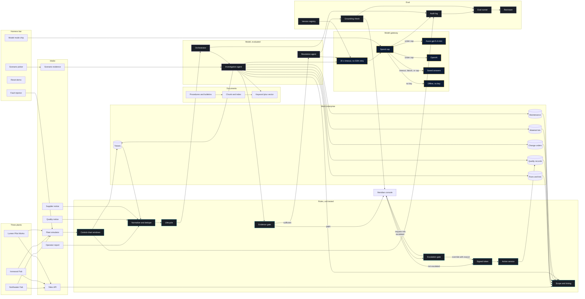

# Logical architecture

**Issue:** G1 (#46)
**Copyright (c) 2026 Bryan C. Weis and Common Consulting Company**

Meridian Precision Systems Quality & Engineering Issue Resolution. This is the **logical** view (what talks to what, and which side of the rules/AI/human boundary it sits on). Physical Azure layout is in [`physical.md`](physical.md).

Thesis from SPEC: engineers decide; AI assembles and reasons over evidence; **rules enforce**. Anything that must be repeatable, auditable, or safety-relevant is deterministic code. Models synthesize ambiguous evidence only, behind citation checks and a human ApprovalToken.

## Diagram

## Legend

| Band | Color in the console | What lives here | Write authority |
|---|---|---|---|
| **Deterministic** | Cyan | SPC / Western Electric, intake, lifecycle, impact features, evidence gate, ApprovalToken, CAPA action service | Yes, but only after a human token |
| **Probabilistic** | Violet | Investigation Agent, Resolution Agent, MAF graph behind `IInvestigationWorkflow` | None |
| **Model gateway** | Gold / navy (pitch) | Azure OpenAI gpt-5.4-mini, OpenAI, saved answers, 20-second timeout, cost ledger, daily cap | None (completions only) |
| **Eval / governance** | Steel | Grounding validator, eval runner, red-team, audit log, version registry | None |
| **Mock enterprise** | Panel | MES, QMS, PLM, ERP, CMMS, ticketing | QMS CAPA write is the action service, not an agent tool |
| **Documents** | Panel | Seeded corpus, scripted scenario records, chunk/embed, hybrid retrieval | Read-only |
| **Harness** | Navy and gold | Fault injector, scenario picker, reset, plant-data Live or Replay, model-mode chip, spend. The banner reads Live when nothing is running | None. Not a console tab |
| **Console** | Charcoal | Sites, Fleet, Tool, Alerts, Tickets, Investigation, Approval, CAPA | Shows state. The engineer decides |

## Narrative

Telemetry from the seeded fleet simulator (and live Fault Injector shapes) hits **SPC windows and Western Electric rules 1–4**. An alert above threshold **auto-creates a ticket**. Operator reports, QMS NCRs, and supplier notices join the same **intake** path: validate, dedupe against an open incident on the same tool/parameter, classify severity. The **lifecycle state machine** is the only legal way to move Alert → Ticket → Investigation → Recommendation/Escalation → Approval → CAPA.

The orchestrator then runs the **Investigation Agent** with a hard tool allowlist (read-only MES/QMS/PLM/ERP/CMMS/ticketing, telemetry window, SPC violations, hybrid document search, deterministic `Impact.Scope`). It cannot diagnose or write. Its output is a typed **Evidence Pack**. The **evidence gate** (code) either passes the pack to the **Resolution Agent** or returns Request-info / Escalate with named gaps. The Resolution Agent has **no tools**; it ranks a root-cause category (engineering change, calibration/alignment, supply-chain material, process drift) with citations and explicit `counterEvidence`. The **grounding validator** rejects unknown IDs and uncited claims.

A human in the console **approves** only when the investigation is not escalated. An escalated case stops at the **escalation gate**: request more evidence, or override with a written reason. A plain approval is refused. Only a passing decision mints a single-use HMAC **ApprovalToken** and lets the action service call the mock QMS CAPA API. Agents are never registered with write tools (enforced by architecture tests).

All model calls go through the **gateway**. The mode is offline, OpenAI, or Azure OpenAI. A live call waits at most 20 seconds and the SDK does not retry. A timeout, a failure, or the daily spend cap falls back to saved answers, and the chip says so. Offline mode is those saved answers and makes no network call. The banner reads Live when no scenario is running. That word is the plant, not the model. Traces, the audit log, and the replay eval sit beside the product.

CauseGuard lets a resolution mention a ruled-out record in order to dismiss it. It escalates when that record is cited as support or named as the cause of its own class. A refused answer is kept as `rejectedAnswer`. Supplier notices are read only for lots the tool used. A recipe setpoint edit with no engineering change order is process drift. Control limits follow the recipe step at each reading, inside a rolling window of 600 readings per sensor.

LangGraph is not in-process. Orchestration is behind `IInvestigationWorkflow`; a stub adapter and MCP-exported tools (stretch) are the swap points. See SPEC §3.1.

## Plants, harness, and the gate

Three fictional plants feed the simulator. Northwater Fab and Ironwood Fab are front-end fabs. Lumen Pilot Works runs strip, clean, and a pilot line. The Sites API lists the plants, returns one plant, and compares one tool family. Scenario SC-5 is one supplier lot that reaches Northwater and Ironwood. It does not reach Lumen.

The screen is two layers. The StatusNeo harness bar holds the fault injector, the scenario picker, reset, plant-data Live or Replay, the model-mode chip, and spend. The Meridian console holds Sites, Fleet, Tool, Alerts, Tickets, Investigation, Approval, and corrective and preventive action. Presenter controls are not console tabs.

Scripted scenarios carry their own evidence. Those records join the read-only tools. The resolution agent sees the full record text. It still has no tools and no write.

## Large-format print

ARCH D sheet (36 × 24 in, landscape), v1.1, 2026-10-14. The mermaid block above is the source. The plotter files are hand-composed so labels do not cross. v1.1 adds the three plants, the Sites API, scenario evidence, the harness bar, and the escalation gate.

- [`print/logical-archD.pdf`](print/logical-archD.pdf)
- [`print/logical-archD.svg`](print/logical-archD.svg)
- [`print/logical.svg`](print/logical.svg)

Regenerate with `pwsh docs/diagrams/render.ps1`. See [`README.md`](README.md).
