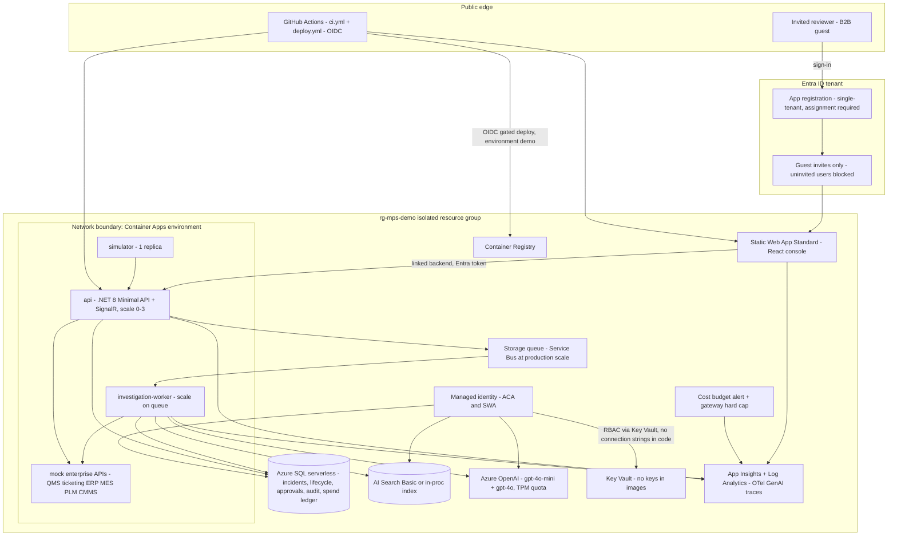

# Physical architecture (hosted demo)

**Issue:** G2 (#47)
**Copyright (c) 2026 Bryan C. Weis and Common Consulting Company**

Hosted demo in Bryan’s Azure subscription, resource group `rg-mps-demo`. Local run is `docker compose` (API, mock enterprise, web, Aspire dashboard) and is **not** this diagram. Bicep is authored in the foundation lane; this file does not deploy anything.

Invite-only. No secrets in Git. Cost-minimal SKUs, scale-to-zero, teardown = delete the resource group after the review.

## Diagram

## Identity, secrets, network

| Control | Demo behavior |
|---|---|
| **Entra ID** | Single-tenant app registration, **user assignment required**. Reviewers are B2B guests. Uninvited accounts never receive a token. Local profile uses a dev user, not Entra. |
| **Managed identity** | Container Apps (and the SWA API link) use a user-assigned identity. Azure OpenAI, SQL, Key Vault, and Search are granted via RBAC. **No access keys in images or App Settings that a PR can print.** |
| **Key Vault** | Holds the few remaining secrets (if any). Apps read through managed identity. Repo has `.env.example` only; gitleaks in CI. |
| **Network boundary** | Demo: Container Apps *environment* is the trust boundary; ingress to `api` is Entra-authenticated. Production target (talk track, not built): Front Door + WAF, private endpoints to SQL/AOAI/KV, Event Hubs for telemetry, APIM in front of the model gateway. |
| **GitHub OIDC** | `deploy.yml` federates to the subscription on repo `ccc-bcweis/mps-quality-agents`, environment `demo`, **required reviewer**. No stored Azure credentials. CI (`ci.yml`) never deploys. Bryan’s go is the gate for Z1/Z2. |

## Scaling, latency, unit cost

| Item | Target |
|---|---|
| API p95 | **&lt; 300 ms**. Investigations are async (queue + worker); the HTTP call returns an investigation id. |
| Investigation p95 | **&lt; 45 s** wall time (tool calls + two model completions + gates). |
| API replicas | Scale **0–3** on HTTP. Worker scales on queue depth. Simulator **1 replica**. |
| SQL | Serverless, auto-pause. Fine for demo concurrency; not a production HA pattern. |
| Azure OpenAI | gpt-4o-mini for investigation tool use, gpt-4o (or equivalent) for resolution. TPM quota is a backstop, not the primary brake. |
| **Unit cost** | **≈ $0.02–0.10 per successful investigation** (tokens + tiny compute). Measure on the metrics screen; do not quote as a contract price. |
| Spend cap | Gateway **hard stop at $2/day** (SQL ledger). Over cap → UI banner **REPLAY MODE**, no live calls. Azure budget alert (~$10/week) and AOAI quota sit behind that. |
| Rollback | Container Apps revisions (blue/green). Prompt/model versions are first-class so an AI regression rolls back without a full app rollback. DR for the demo = IaC redeploy + SQL geo-backup (not configured until Z2). |

## CI → deploy path

1. PR: build, analyzers, tests, coverage, format, eval in replay, CodeQL, gitleaks, dependency review.
2. Merge to `main` (Bob, then Bryan for lane merges).
3. `deploy.yml` is **manual / environment-gated**. OIDC mints an Azure token, Bicep applies `rg-mps-demo`, ACR gets the image, Container Apps revision and SWA production token update.
4. Smoke: Entra sign-in as an invited guest, LIVE badge, spend meter, S1 in replay then live.

Open: Azure OpenAI quota in the subscription was not checked from this box (no Azure CLI). Bryan or Bob confirm region and gpt-4o-mini / gpt-4o quota before Z2.
