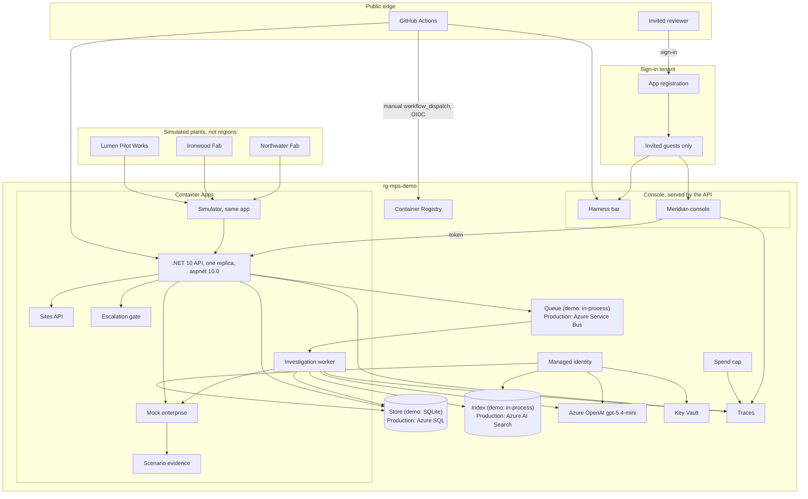

# Physical architecture (hosted demo)

**Issue:** G2 (#47)
**Copyright (c) 2026 Bryan C. Weis and Common Consulting Company**

Hosted demo in Bryan’s Azure subscription, resource group `rg-mps-demo`. Local run is `docker compose` (the same app image plus the Aspire dashboard) and is **not** this diagram. Bicep is authored in the foundation lane; this file does not deploy anything.

Invite-only. No secrets in Git. Cost-minimal SKUs, one always-on API replica, teardown = delete the resource group after the review.

## Diagram

## Production swaps

The demo keeps every moving part in one Container App. Each swap below changes an adapter, not the agents or the workflow.

| Demo | Production | Why |
|---|---|---|
| In-process queue | Azure Service Bus (sessions per incident, dead-letter) | Durable hand-off, retry, scale the worker on depth |
| SQLite on the app volume | Azure SQL (zone-redundant) | Concurrency, point-in-time restore, audit retention |
| In-process document index | Azure AI Search (hybrid vector + keyword) | Corpus size, security trimming, relevance tuning |
| In-memory spend ledger | Azure SQL ledger table | Cap survives restarts and replicas |
| Container Apps ingress | Front Door + WAF, private endpoints, APIM in front of the model gateway | Edge protection, private data plane, per-caller quotas |
| App Insights traces | Plus Event Hubs for tool telemetry | Plant-scale ingest |

## Plants and the two screen layers

The three plants are simulated. They are not Azure regions and not separate resource groups. Northwater Fab and Ironwood Fab are front-end fabs. Lumen Pilot Works is strip, clean, and a pilot line. One simulator replica streams all three from one seed. The API serves `GET /api/sites`, `GET /api/sites/{siteId}`, and `GET /api/sites/compare`. Scenario SC-5 is one supplier lot used at Northwater and at Ironwood.

The hosted console is served by the API container. Static Web Apps are not deployed (`deployStaticWeb` is false). The page still draws two layers. The harness bar is the presenter strip: fault injector, return on investment, metrics, reset, the scenario picker, plant-data Live or Replay, the model-mode chip, and spend. When nothing is running the banner reads Live. The Meridian console is the product: Sites, Fleet, Tool, Alerts, Tickets, Investigation, Approval, and corrective and preventive action. A harness panel is not a console tab.

Scripted scenarios carry their own evidence on the mock read path. The resolution agent sees the full record text. An escalated investigation cannot be approved straight into a corrective and preventive action. The API refuses that approval. The approver requests more evidence, or overrides with a written reason.

## Identity, secrets, network

| Control | Demo behavior |
|---|---|
| **Entra ID** | Auth mode `azure`: Container Apps Easy Auth, your own tenant and sign-in app. `ADMIN_EMAILS` is required or the app will not start. No admin email is built into the code. Auth mode `local` (the default) has no sign-in, the local user is the admin, and it is for localhost. |
| **Managed identity** | Container Apps (and the SWA API link) use a user-assigned identity. Azure OpenAI, SQL, Key Vault, and Search are granted via RBAC. **No access keys in images or App Settings that a PR can print.** |
| **Key Vault** | Holds the few remaining secrets (if any). Apps read through managed identity. Repo has `.env.example` only; gitleaks in CI. |
| **Network boundary** | Demo: Container Apps *environment* is the trust boundary; ingress to `api` is Entra-authenticated. Production target (talk track, not built): Front Door + WAF, private endpoints to SQL/AOAI/KV, Event Hubs for telemetry, APIM in front of the model gateway. |
| **GitHub OpenID Connect** | `deploy.yml` is manual `workflow_dispatch` on environment `azure-demo`. A push or a merge does not deploy. A fork without the Azure secrets and variables skips. The federated credential trusts this repo's `azure-demo` environment. CI never deploys. |

## Scaling, latency, unit cost

| Item | Target |
|---|---|
| API p95 | **&lt; 300 ms**. Investigations are async (queue + worker); the HTTP call returns an investigation id. |
| Investigation p95 | **&lt; 45 s** wall time (tool calls + two model completions + gates). |
| API replicas | **One** replica (`minReplicas` 1, `maxReplicas` 1), 0.5 vCPU, 1 GiB. About $33 more per month than 0.25 vCPU and 0.5 GiB, approved after failed probes on 18 Oct 2026 (working set 590-673 MiB). The image is `mps-app` on `mcr.microsoft.com/dotnet/aspnet:10.0`. The worker and the simulator run in that same app. |
| Store | SQLite in the container. `deploySql` is false. Replacing the replica wipes the demo data. |
| Azure OpenAI | `gpt-5.4-mini` in `eastus2` (managed identity) for both investigation and resolution. A live call times out after 20 seconds with no SDK retries, then the gateway uses saved answers. |
| **Unit cost** | **≈ $0.02–0.10 per successful investigation** (tokens + tiny compute). Measure on the metrics screen; do not quote as a contract price. |
| Spend cap | Gateway **hard stop at $2/day**. Over the cap, or after a timeout, the chip says the mode is falling back to saved answers. An Azure budget of $40 per month is declared and is created only when a budget email is set. |
| Rollback | Container Apps revisions (blue/green). Prompt/model versions are first-class so an AI regression rolls back without a full app rollback. DR for the demo = IaC redeploy + SQL geo-backup (not configured until Z2). |

## CI → deploy path

1. Pull request and push to `main`: `ci.yml` jobs `build` (format, tests except the slow category, replay eval, coverage upload), `web`, `slow tests`, `bicep` (compile only), `gitleaks`, and `dependency review` on pull requests. `codeql.yml` job `analyze` covers C#. None of these deploy.
2. Merge to `main` (Bob, then Bryan for lane merges). A merge does not deploy.
3. `deploy.yml` is **manual `workflow_dispatch`**. OpenID Connect mints an Azure token only when this repo's `azure-demo` secrets and variables are present. Otherwise the job skips. Bicep applies `rg-mps-demo` and the registry builds `mps-app`. There is no Static Web App update.
4. Smoke after deploy: `/health` returns 200, `/api/tools` returns 401 with no principal, and `/` redirects to `/landing.html`.

Azure OpenAI runs gpt-5.4-mini in eastus2 behind the gateway cap (gpt-4o-mini was blocked for new deployments). Each sensor keeps 600 readings. Limits follow the recipe step. A ruled-out record may be mentioned and must not be cited as support. A refused model answer is stored on the escalation.

## Large-format print

ARCH D sheet (36 × 24 in, landscape), v1.2, 2026-10-16. v1.2 shows each data node as the demo service with its production swap. The mermaid block above is the source. The plotter files are hand-composed so labels do not cross. v1.1 adds the three simulated plants, the Sites routes, the harness-over-console split, scenario evidence on the mock read, and the refusal of a bare approve. The GitHub environment name in the workflow and in this file is `azure-demo`. See [`cicd.md`](cicd.md).

- [`print/physical-archD.pdf`](print/physical-archD.pdf)
- [`print/physical-archD.svg`](print/physical-archD.svg)
- [`print/physical.svg`](print/physical.svg)

Regenerate with `pwsh docs/diagrams/render.ps1`. See [`README.md`](README.md).
