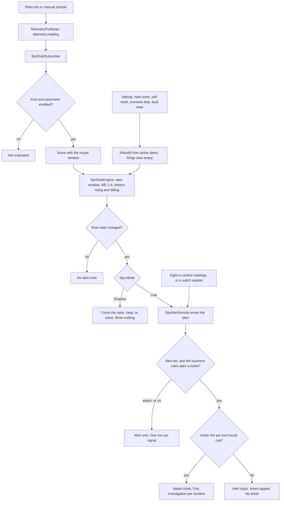

# SPC alert flow

**Copyright (c) 2026 Bryan C. Weis and Common Consulting Company**

How a reading becomes a watch, an alert, a ticket, or a clear. The rules and the numbers are `data/metadata/spc-rules.yaml` (ADR-015). This is a review drawing. The ARCH D sheets under `print/` are hand-composed and are not regenerated from this file.

## Diagram

## Narrative

The plant loop no longer runs a second SPC pass over memory. Publishing the reading is what evaluates it. A manual sample is ingested into the same pending list and published as the same event.

The engine keeps a short ring and a few counters per series. It does not scan the 600-point chart window. SQLite and the fleet hub are updated only when the series moves: a new watch or alert, an escalation on that same alert, a change to the set of live rules, or a clear.

Clearing does not read injected-fault state. After a reset the rings are empty and any alert that is still stored is the series state. Later nominal readings clear it through the hysteresis. A hard reset has already deleted the alerts, so there is nothing to rebuild. Shadow mode walks the same decisions and records the counts.
