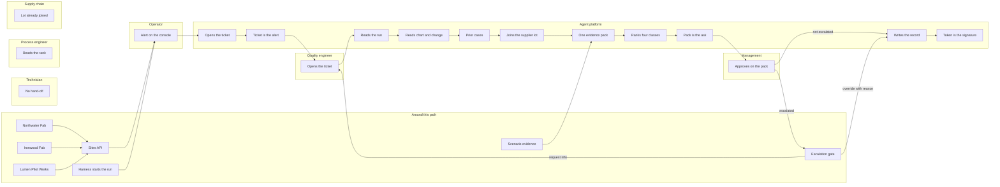

# To-be investigation flow

**Issue:** G6
**Copyright (c) 2026 Bryan C. Weis and Common Consulting Company**

Meridian Precision Systems Quality and Engineering Issue Resolution. This is a StatusNeo reading of the **assisted** investigation: the same stages and the same lanes as the current process, plus the MPS agent platform. The customer, the tool, and the durations are fictional. Every duration on the print sheet is marked **illustrative / simulated**.

The worked example is the same alarm on the **MX-400 etch**, a fictional etch tool. The path is the one the current sheet walks, with each numbered hand-off moved. A violet **AGENT** badge keeps the number of the red **MANUAL** badge it replaces. A teal **HUMAN** badge keeps the number where a person still acts. The human stays the approver.

The current sheet is [`as-is-flow.md`](as-is-flow.md). The screen-order drawing of the same assisted path is [`investigation-flow.md`](investigation-flow.md). The side-by-side comparison is `print/as-is-vs-to-be-archD.pdf`. The consultative note is [`../analysis/current-vs-future-state.md`](../analysis/current-vs-future-state.md).

## Diagram

Violet **AGENT** badges, teal **HUMAN** badges, and green **ERROR REMOVED** badges are on the print sheet. Mermaid cannot carry those badges. The plotter file does. The technician, the process engineer, and supply chain stay on the sheet. They have no numbered step on this path.

## Stage bands

The bands across the top are elapsed time for this simulated incident, not labor hours. The stage names match the current sheet. Detect through Diagnose sums to the **1.2-day** simulated time to a root-cause hypothesis: the expected case in PLAN section 6.5, a 70 percent reduction of the 4.0-day baseline. The split inside those 1.2 days is illustrative. CAPA at **40.3 days** is the simulated record cycle, a 35 percent reduction of the 62-day baseline, not part of the 1.2 days. Decide / approve stays **2.0 days**. The ROI model does not shrink those days.

| Stage | Simulated duration | What changes |
|---|---|---|
| Detect | 0.1 day | Statistical process control opens the ticket with the tool, the chamber, and the recipe. AGENT 1. The spoken alarm is gone. |
| Triage | 0.2 day | The alert is the ticket. AGENT 2. The quality engineer opens it. HUMAN 3. The recipe step is already on the record. |
| Gather evidence | 0.4 day | Read-only calls bring the run sheet, the historian, the control chart, the change log, prior cases, and the supplier lot into one pack. AGENT 4 through AGENT 8. No meeting. |
| Diagnose | 0.5 day | Four cause classes are ranked, and the rank cites what would rule a class out. AGENT 9. The process engineer reads it and does not state it from memory. |
| Decide / approve | 2.0 days | The pack is the ask. AGENT 10. Management approves with a signed token. HUMAN 11. The cause is cited. |
| CAPA | 40.3 days | The action service writes the record from the approved pack. AGENT 12. The token is the signature. AGENT 13. There is no second signature. |
| Detect through Diagnose | 1.2 days | Simulated time to a hypothesis. |
| All stages |  | 11 agent steps and 2 human steps. Same 13 numbers as the current sheet. |

## Lanes

| Lane | Colour on the print sheet | What this lane does on the assisted path |
|---|---|---|
| Operator | Teal | Sees the alert on the console. Does not phone it in. |
| Technician | Orange | No hand-off. The ticket is not retyped, and the run sheet is not pasted. |
| Process engineer | Blue | Reads the ranked cause. Does not state it from the last alarm. |
| Quality engineer | Slate | Opens the ticket and takes the investigation. HUMAN 3. |
| Supply chain | Gold | No email lookup. The supplier lot is already joined to the run. |
| Management | Green | Approves on the pack. HUMAN 11. The human stays the approver. |
| MPS agent platform (StatusNeo) | Violet | Replaces the other eleven hand-offs. Read-only until a signed token exists. Does not approve. |

## Steps

The number is the number on the current sheet. The lane is where that number sits now.

| Step | Lane | Badge | Error removed |
|---|---|---|---|
| Alert on the console. The MX-400 etch breaks a limit. | Operator |  |  |
| Statistical process control opens the ticket with tool, chamber, and recipe. | MPS agent platform | AGENT 1 | E1 Spoken alarm |
| The alert is the ticket. Tool, time, and symptom are not retyped. | MPS agent platform | AGENT 2 | E2 Ticket retyped |
| Opens the ticket. The recipe step stays on it. | Quality engineer | HUMAN 3 | E3 Data gap |
| Reads the manufacturing execution system. Runs, lots, and recipe. | MPS agent platform | AGENT 4 | E4 Spreadsheet paste |
| Reads the historian, the control chart, and the engineering-change log. | MPS agent platform | AGENT 5 | E5 Missed engineering change |
| Retrieves prior cases onto the same ticket. | MPS agent platform | AGENT 6 | E6 Data gap |
| Joins the supplier lot to the manufacturing run. | MPS agent platform | AGENT 7 | E7 Wrong lot traced |
| One evidence pack. Each file is cited once. No meeting. | MPS agent platform | AGENT 8 | E8 Data gap |
| Ranks four cause classes and cites what would rule one out. | MPS agent platform | AGENT 9 | E9 Bias toward the last known cause |
| The pack is the ask. Citations are attached. | MPS agent platform | AGENT 10 |  |
| Approves on the pack. Signed token, single use. The cause is cited. | Management | HUMAN 11 | E10 Uncited approval |
| Writes the corrective and preventive action from the approved pack. | MPS agent platform | AGENT 12 | E11 Re-keyed record |
| The token is the signature. It was already given at approval. | MPS agent platform | AGENT 13 |  |

The four cause classes, checked on every incident, are an engineering change, equipment out of spec, supply-chain material, and process drift. The rank has to name the signal that would rule a class out.

## Narrative

The operator still sees the alarm first. It is on the console, for the MX-400 etch at Northwater Fab, with the chamber and the recipe. The harness bar may have started the scenario. It is not a lane on this sheet. Nobody repeats the alarm in the aisle. AGENT 1 is the statistical process control alert that opens the ticket. E1 is removed because the chamber is a field on that ticket, not a sentence heard and written later.

AGENT 2 keeps the ticket equal to the alert: tool, time, and symptom. E2 is removed because nobody retypes it. The quality engineer opens the ticket and takes the investigation. HUMAN 3. E3 is removed because the recipe step is already on the record. A reply-all cannot drop a field that was never retyped. That open, and the later approval, are the two human steps on this path.

Gathering is five agent steps and no meeting. AGENT 4 reads the manufacturing run. E4 is removed because the run sheet is not pasted into a spreadsheet. AGENT 5 reads the historian, the control chart, and the engineering-change log into the same pack. E5 is removed because the log is not a separate scroll checked by eye. AGENT 6 retrieves prior cases onto the ticket. E6 is removed because the cases are not left in a folder. AGENT 7 joins the supplier lot to the run lot. E7 is removed because the lot is not an email that might name the wrong one. AGENT 8 is the pack those reads already share. E8 is removed because one pack records which file was current. There is no meeting to reconcile spreadsheets.

AGENT 9 ranks four cause classes and cites the confounder. E9 is removed because the last similar alarm is not the cause by default. The process engineer reads that rank. The process engineer does not state it.

AGENT 10 puts the pack in front of the approver, with the citations attached. The ask is no longer a mail thread. Management approves. HUMAN 11. The signature is a single-use token bound to that pack. E10 is removed because the approval cites the pack. Decide / approve stays 2.0 days. The model does not hold write authority, and the agent does not approve.

AGENT 12 writes the corrective and preventive action from the approved pack, through the action service, and only because the token is present. E11 is removed because the narrative is not re-keyed. The files do not stay behind in a mail thread. AGENT 13 records that the token was the signature. Management does not sign a second time, and does not sign a record that hides the files.

Eleven violet badges. Two teal badges. Eleven green badges, one for each error on the current sheet. The print sheet's callout box is the legend for how E1 through E11 are removed.

## Around this path

This numbered path is one etch alarm at Northwater Fab. It is the sufficient-evidence path. Ironwood Fab is the other front-end fab. Lumen Pilot Works is strip, clean, and a pilot line. The Sites API is how a reader lists the three and compares one family. Scenario SC-5 is a different story: one supplier lot that reaches Northwater and Ironwood. It is not the MX-400 etch on this sheet.

Scripted scenarios carry their own evidence. That text is in the pack the resolution agent reads. An escalated case does not continue into the record write. The escalation gate offers more evidence, or an override with a written reason. Management remains the approver either way.

## Glossary on the sheet

| Short form | Plain expansion |
|---|---|
| MES | manufacturing execution system |
| SPC | statistical process control |
| ECN | engineering change notice |
| QMS | quality management system |
| CAPA | corrective and preventive action |

Historian, supplier lot, signed token, and the MX-400 etch are already plain words. The sheet does not abbreviate them.

## Large-format print

ARCH D sheet (36 by 24 in, landscape), **v1.1**, 2026-10-14. The mermaid block above is the review source. The plotter file is hand-composed so labels do not cross. v1.1 names Northwater on the alert, keeps the harness bar outside the lanes, and notes the escalation gate and the SC-5 lot in the glossary strip.

- [`print/to-be-flow-archD.pdf`](print/to-be-flow-archD.pdf)
- [`print/to-be-flow-archD.svg`](print/to-be-flow-archD.svg)
- [`print/to-be-flow.svg`](print/to-be-flow.svg)

Regenerate with `pwsh docs/diagrams/render.ps1 -- --only to-be-flow`. See [`README.md`](README.md).
